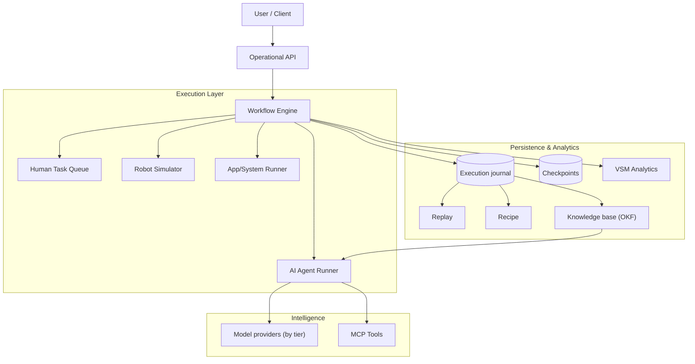

# Agentic Workflow Architecture (AWA)

> **A system for a new way to automate enterprise workflow in the agentic era, natively made to work with AI.**

AWA is a next-generation specification and framework designed to build, run, and visualize **AI-native business processes**. It moves beyond traditional BPMN by treating **AI Agents** as first-class citizens alongside humans, robots, and software systems.

---

## What is AWA?

In the age of Generative AI, traditional workflows are too rigid. Agents need **autonomy**, **context**, and **tools**.

**AWA (Agentic Workflow Architecture)** provides the standard for defining queryable, maintainable, and intelligent workflows where:
- **AI Agents** reason and use tools (MCP) to complete tasks.
- **Humans** are loop-in for critical decisions and approvals.
- **Robots** execute physical world actions.
- **Systems** handle high-speed deterministic processing.

It solves the "Black Box" problem of AI agents by providing a **structured, observable, and queryable** backbone for agent orchestration.

---

## What AWA standardises

AWA 1.1 is a specification with a reference implementation and a conformance suite. The guiding principle is **fixed outcome, free strategy**: an AI agent may reach a result by different means each time, so AWA fixes what must be true of the result, records how it was reached, and refuses results it cannot verify.

| Layer | What it gives you | Specification |
|---|---|---|
| **Document** | A workflow as JSON: activities, actors, roles, edges, decision tables, events | Sections 4, 8 |
| **Flow** | Sequence, conditional routing, parallel split and join, timers, compensation | Sections 5, 13 |
| **Decisions** | A native decision table engine with a specified entry language and strict hit policies; decisions can feed one another. External rule engines plug in where a rule base already exists | Section 5.5 |
| **Outcome contracts** | Per activity: output schema, postconditions, budgets, escalation to a human. Checked deterministically, failing closed | Sections 7, 11 |
| **Resilience** | Retry with backoff, dead letters, checkpoints, recovery in another process, idempotency keys | Section 10 |
| **Model routing** | Models named by capability tier (`tier:reasoning`, `tier:fast`). One router resolves a tier to Google, OpenAI, any open-source model server, or a small model embedded in the engine, and falls back down the list when a provider fails | Section 12 |
| **Model decisions** | A decision node can be decided by a model, within options the workflow enumerates; a table can decide the anticipated cases first | Section 16 |
| **Tools** | Agents call HTTP APIs, commands, JSON-RPC, gRPC and MCP tools. Every call is journalled: which tool, when, arguments, result, and a link to what ran | Section 17 |
| **Journal** | An append-only record of every run at three levels: execution, the actor's reasoning, and the engine's own decisions | Section 9 |
| **Explanation** | A replay you can scrub through, and a recipe that explains how to rebuild the workflow from scratch | Section 14 |
| **Business events** | Workflows publish business events and wait for them, in CloudEvents form, with correlation and a deadline that has its own path. A run that waits two weeks costs nothing while it waits | Section 18 |
| **Journeys** | The layer above workflows: the stages a customer or an order passes through, which workflows serve each stage, goals and exits. Linked to every run by `run_id`. A journey also records its touchpoints (channel, technology, and what changes hands: contract, attestation, invoice, receipt, certificate), an estimate of the customer's mood that always says whether it was measured or inferred, and how customers move from one journey to the next | Section 19 |
| **Counterfactual replay** | Re-run a recorded run with another model, prompt, contract or rule while the rest of the world is held as recorded, and get a regression report | Section 20 |
| **Knowledge** | Strategies, failure patterns and lessons distilled from runs, compounding over time, reviewed by people, exported as an Open Knowledge Format bundle | Section 15 |

The full text is in [`docs/specification.md`](docs/specification.md). What it means to implement AWA is defined by the cases in [`spec/conformance`](spec/conformance).

### Implementations

| SDK | Conformance levels |
|---|---|
| TypeScript (reference) | `document`, `core`, `decision`, `verified`, `recorded`, `resilient`, `contract`, `flow`, `events`, `model_decision`, `tools`, `journeys`, `replay`, plus recipe, knowledge and model routing |
| Python | `document`, `core`, `decision`, `verified`, `recorded`, `resilient`, `contract`, `flow`, `events` |
| Java | Data model only |

### See a run

Open [`tools/visualization/replay.html`](tools/visualization/replay.html) in a browser and pick a sample run, or read the [recipe](examples/claims-settlement/RECIPE.md) and the [knowledge bundle](examples/claims-settlement/knowledge/index.md) produced from the same run.

To see journeys, open [`tools/visualization/journey.html`](tools/visualization/journey.html): six customers through a year with an insurer (buying a policy, claiming on it, renewing it), from an atlas of the journeys down to the workflow run behind any moment. The data comes from [`examples/claims-journey`](examples/claims-journey); the reasoning behind the view is in [`docs/ux/journey-visualisation-research.md`](docs/ux/journey-visualisation-research.md).

Journeys outlive the process that touches them. Each of these commands is a separate process working on the same runtime directory:

```bash
awa journey add intake.awa.json claim.journey.json
```

```bash
awa journey publish claim.submitted -d '{"customer_id":"c-1"}'
```

```bash
awa journey list --stalled
```

```bash
awa journey export -o portfolio.json
```

The exported file opens in the journey view, and in the measures page [`tools/visualization/dashboard.html`](tools/visualization/dashboard.html): who is stuck and whose it is, what became of each journey, how each workflow's runs went, with every number opening the customers behind it. `awa measures` prints the same measures (specification section 21) and `GET /api/v1/measures?format=openmetrics` gives them to a metrics system. `awa serve` with `AWA_DATA_DIR` offers the same over HTTP, and `journey.html?live=http://localhost:3000` follows it as journeys progress.

To ask what a recorded run would have done under a different model or rule:

```bash
awa replay workflow.awa.json run.jsonl --candidate changed.awa.json --ai recorded
```

---

## In ChatGPT and other assistants

[`apps/mcp-server`](apps/mcp-server) is an MCP server with embedded views (MCP Apps), packaged as a ChatGPT plugin in [`plugins/awa`](plugins/awa). In a conversation it validates a workflow or journey document, shows a workflow as a graph with the data that moves, simulates a run and replays it, plays business events through customer journeys, and opens the measures dashboard. It simulates only: no tool, command, model or production system named by a document is ever called, and nothing is kept between calls.

```bash
cd sdk/typescript && npm install && npm run build
```

```bash
cd apps/mcp-server && npm install && npm start
```

It runs today in development mode (ChatGPT developer mode, or any MCP client, over `http://127.0.0.1:8787/mcp` or stdio). [`apps/mcp-server/SUBMISSION.md`](apps/mcp-server/SUBMISSION.md) lists what is ready for the store and what only the owner can do: hosting, domain verification, the demo recording and the submission itself.

## Other features

- **Multi-actor**: humans, AI agents, robots and applications in one flow, with a Kanban board for human tasks.
- **Value stream analytics**: process, cycle and lead time, and DOWNTIME waste detection.
- **Queryable**: the workflow is a graph you can query from code.
- **Operational API**: REST server with JWT and API key authentication, role-based access and rate limiting.
- **Visualisation**: 2D (ReactFlow) and 3D (Babylon.js) diagrams of a definition, in addition to the replay.

---

## Quick Start (TypeScript)

### 1. Install

```bash
npm install -g agentic-workflow-architecture
```

### 2. Define and Run

```typescript
import { WorkflowEngine, workflow } from 'agentic-workflow-architecture';

const orderProcess = workflow('Order Fulfillment', '1.0.0')
  .addActivity({
    name: 'Analyze Data',
    role_id: 'ai-analyst',
    actor_type: 'ai_agent'
  })
  .build();

const engine = new WorkflowEngine(orderProcess, {
  gemini_api_key: process.env.GEMINI_API_KEY,
  default_ai_model_id: 'gemini-3-flash-preview' // Documentation-verified default
});

await engine.run();
```

Run from the command line, keeping the journal:

```bash
npx awa run workflow.awa.json --journal run.journal.jsonl --key YOUR_GEMINI_API_KEY
```

Choose model providers, in order of preference. Each tier falls back down the list, so this run keeps working on a local model if the cloud one fails:

```bash
npx awa run workflow.awa.json --providers google,ollama,embedded --journal run.journal.jsonl
```

| Provider | Needs |
|---|---|
| `google` | `GEMINI_API_KEY` |
| `openai` | `OPENAI_API_KEY` |
| `ollama` | A running [Ollama](https://ollama.com); `OLLAMA_BASE_URL` if not on localhost |
| `embedded` | `npm install @huggingface/transformers`. Runs a small open-source model in-process: no server, no key |

Small embedded models follow a reply format well and judge poorly. [`docs/embedded-models.md`](docs/embedded-models.md) has measurements and advice on where to use them.

Turn the journal into a recipe, and into knowledge:

```bash
npx awa recipe workflow.awa.json run.journal.jsonl -o RECIPE.md
```

```bash
npx awa knowledge ingest workflow.awa.json run.journal.jsonl
```

---

## Architecture

AWA is built on a modular architecture designed for scalability and observability.



---

## Project Structure

The repository is organized into SDKs, Specifications, and Applications.

| Directory | Description |
|-----------|-------------|
| `sdk/typescript` | Core **TypeScript SDK** and CLI tools. |
| `sdk/python` | **Python SDK** for data science and AI engineers. |
| `apps/kanban-web` | **Kanban Web App** (Next.js) for human task management. |
| `spec/json-schema` | Normative JSON Schemas. |
| `spec/conformance` | Language-neutral conformance cases. |
| `spec/` (other) | Informative projections: OpenAPI, GraphQL, Avro, DDL. |
| `docs/specification.md` | The specification. |
| `tools/visualization` | Replay and diagram viewers. |
| `examples/` | End-to-end examples (Insurance, Retail, Banking). |

---

## Kanban Web Application

AWA includes a modern **Kanban Web Application** for managing human tasks. It provides:

- **Real-time Updates**: Tasks appear instantly as agents assign them.
- **Rich Task Details**: View full context, actor metadata, and input/output data in a responsive modal.
- **Visual Cues**: Distinct visual styles for tasks created by AI Agents, Robots, or Systems.

To use the Kanban app, clone the repository and run it locally:

```bash
git clone https://github.com/yannickhuchard/agentic-workflow-architecture.git
cd agentic-workflow-architecture/apps/kanban-web
npm install
npm run dev
# Open http://localhost:3000
```

---

## Documentation & Resources

- **[Specification](docs/specification.md)**: The normative text.
- **[Conformance suite](spec/conformance/README.md)**: How to test an implementation.
- **[Skill Definition](skills/agentic-workflow-architecture/SKILL.md)**: Guide for AI assistants (describes 1.0; not yet updated for 1.1).
- **[CLI Guide](sdk/typescript/docs/cli-guide.md)**: Command-line reference.
- **[API Reference](sdk/typescript/docs/operational-api.md)**: REST API documentation.
- **[Examples](examples/)**: Start with [claims-settlement](examples/claims-settlement/), which shows most of 1.1.

---

## License

Apache 2.0

## Authors

- [Yannick HUCHARD](https://yannickhuchard.com)