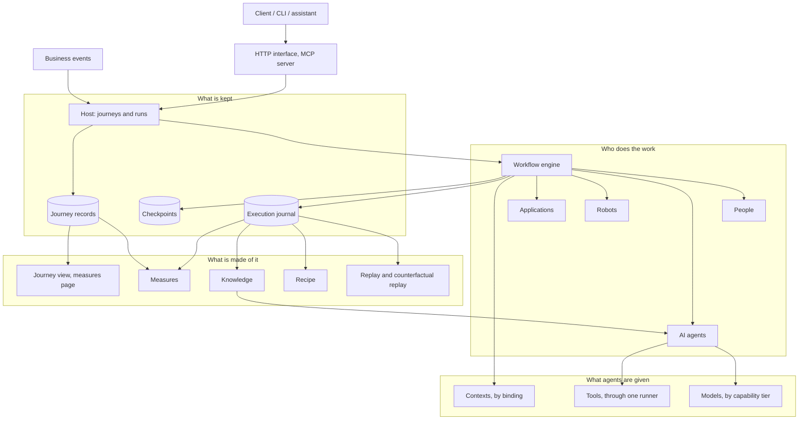

# Agentic Workflow Architecture (AWA)

> **A system for a new way to automate enterprise workflow in the agentic era, natively made to work with AI.**

AWA is a next-generation specification and framework designed to build, run, and visualize **AI-native business processes**. It moves beyond traditional BPMN by treating **AI Agents** as first-class citizens alongside humans, robots, and software systems.

---

## What is AWA?

In the age of Generative AI, traditional workflows are too rigid. Agents need **autonomy**, **context**, and **tools**.

**AWA (Agentic Workflow Architecture)** provides the standard for defining queryable, maintainable, and intelligent workflows where:
- **AI Agents** reason and use tools (MCP) to complete tasks.
- **Humans** are loop-in for critical decisions and approvals.
- **Robots** execute physical world actions.
- **Systems** handle high-speed deterministic processing.

It solves the "Black Box" problem of AI agents by providing a **structured, observable, and queryable** backbone for agent orchestration.

---

## What AWA standardises

AWA 1.1 is a specification with a reference implementation and a conformance suite. The guiding principle is **fixed outcome, free strategy**: an AI agent may reach a result by different means each time, so AWA fixes what must be true of the result, records how it was reached, and refuses results it cannot verify.

| Layer | What it gives you | Specification |
|---|---|---|
| **Document** | A workflow as JSON: activities, actors, roles, edges, decision tables, events | Sections 4, 8 |
| **Flow** | Sequence, conditional routing, parallel split and join, timers, compensation | Sections 5, 13 |
| **Decisions** | A native decision table engine with a specified entry language and strict hit policies; decisions can feed one another. External rule engines plug in where a rule base already exists | Section 5.5 |
| **Outcome contracts** | Per activity: output schema, postconditions, budgets, escalation to a human. Checked deterministically, failing closed | Sections 7, 11 |
| **Resilience** | Retry with backoff, dead letters, checkpoints, recovery in another process, idempotency keys | Section 10 |
| **Model routing** | Models named by capability tier (`tier:reasoning`, `tier:fast`). One router resolves a tier to Google, OpenAI, any open-source model server, or a small model embedded in the engine, and falls back down the list when a provider fails | Section 12 |
| **Model decisions** | A decision node can be decided by a model, within options the workflow enumerates; a table can decide the anticipated cases first | Section 16 |
| **Tools** | Agents call HTTP APIs, commands, JSON-RPC, gRPC and MCP tools. MCP servers (over standard input and output or Streamable HTTP) and gRPC services are reached by built-in executors, only where the deployment allows. Every call is journalled: which tool, when, arguments, result, and a link to what ran | Section 17 |
| **Agents over A2A** | An activity can be performed by an agent elsewhere, reached over the Agent2Agent protocol 1.0, under the same outcome contract, verification, permissions and record as any actor; an agent that asks for input makes the run wait for it. `awa serve --a2a` offers a workflow to other agents as an A2A agent | Section 28 |
| **Contexts** | What activities share beside the data that flows: an activity is given the contexts it is bound to read and no other, and a write needs a binding that allows it. "This agent cannot read the fraud signals" is a property of the document that the engine upholds | Section 22 |
| **Service levels** | The time work takes, waits and retries included, compared with what was promised: warnings and breaches are recorded, and work still waited for can be made to fail | Section 23 |
| **Journal** | An append-only record of every run at three levels: execution, the actor's reasoning, and the engine's own decisions | Section 9 |
| **Explanation** | A replay you can scrub through, and a recipe that explains how to rebuild the workflow from scratch | Section 14 |
| **Business events** | Workflows publish business events and wait for them, in CloudEvents form, with correlation and a deadline that has its own path. A run that waits two weeks costs nothing while it waits | Section 18 |
| **Journeys** | The layer above workflows: the stages a customer or an order passes through, which workflows serve each stage, goals and exits. Linked to every run by `run_id`. A journey also records its touchpoints (channel, technology, and what changes hands: contract, attestation, invoice, receipt, certificate), an estimate of the customer's mood that always says whether it was measured or inferred, and how customers move from one journey to the next | Section 19 |
| **Shared store** | Several hosts, on several machines, keep journeys and runs in one PostgreSQL database and take any work. Each operation holds only the subjects it touches; no event is taken twice or lost, no record has a gap, and a host that dies leaves nothing half done. TypeScript and Python hosts can share one store | Section 29 |
| **Counterfactual replay** | Re-run a recorded run with another model, prompt, contract or rule while the rest of the world is held as recorded, and get a regression report | Section 20 |
| **Measures** | 56 measures of journeys, stages, workflows and activities, computed from the record, each with the number it was computed over: completion, where customers leave, right first time, work against waiting, cost. Also in the OpenMetrics format | Section 21 |
| **Telemetry** | Every run and journey in OpenTelemetry: a trace per run with spans for attempts, tool calls, model calls (with token usage, in the generative AI conventions), decisions and waits, and a trace per journey linked to its runs. Identifiers come from the run id, so every implementation, live or from a journal, gives the same ones. Sent over OTLP without ever holding up a run; inputs and outputs only when you opt in | Section 26 |
| **Knowledge** | Strategies, failure patterns and lessons distilled from runs, compounding over time, reviewed by people, exported as an Open Knowledge Format bundle | Section 15 |
| **Evidence** | A report for regulators and auditors, computed from the record: what ran, which models decided what, every human decision and escalation, every contract and verification result, refusals, failures, compensations, tool calls by target, data by payload mode, and the records held. Every statement cites the journal records it rests on, and each part names the EU AI Act articles (12, 13, 14, 15, 26), NIST AI RMF functions and ISO/IEC 42001 clauses it can serve. Evidence a deployer can use, not a certification of compliance | Section 32 |
| **Evaluation** | Datasets built from recorded runs (what each AI activity was given, and the outcome accepted or rejected), a candidate model or workflow scored against them per activity with its regressions, and shadow runs of a candidate beside production that never act on the world | Section 33 |

The full text is in [`docs/specification.md`](docs/specification.md). What it means to implement AWA is defined by the cases in [`spec/conformance`](spec/conformance).

### Implementations

| SDK | Conformance levels |
|---|---|
| TypeScript (reference) | Every level (23, `shared_store` with the optional package `pg`), plus the recipe, Open Knowledge Format exchange, model providers for Google, OpenAI, Ollama and an embedded model, and the views |
| Python | Every level (23, `shared_store` with the extra `postgres`), the same commands (`run`, `validate`, `journey`, `measures`, `replay`, `evidence`, `eval`, `knowledge`, `task`, `telemetry`, `serve`) and the same HTTP routes; its AI agent calls models through OpenAI-compatible and Ollama providers. No recipe, Open Knowledge Format exchange, Google or embedded provider, or views |
| Java | A data model of AWA 1.1 workflow and journey documents (read, build, write; every example and conformance document round-trips exactly), without an engine |

### See a run

Open [`tools/visualization/replay.html`](tools/visualization/replay.html) in a browser and pick a sample run, or read the [recipe](examples/claims-settlement/RECIPE.md) and the [knowledge bundle](examples/claims-settlement/knowledge/index.md) produced from the same run.

To see journeys, open [`tools/visualization/journey.html`](tools/visualization/journey.html): six customers through a year with an insurer (buying a policy, claiming on it, renewing it), from an atlas of the journeys down to the workflow run behind any moment. The data comes from [`examples/claims-journey`](examples/claims-journey); the reasoning behind the view is in [`docs/ux/journey-visualisation-research.md`](docs/ux/journey-visualisation-research.md).

Journeys outlive the process that touches them. Each of these commands is a separate process working on the same runtime directory:

```bash
awa journey add intake.awa.json claim.journey.json
```

```bash
awa journey publish claim.submitted -d '{"customer_id":"c-1"}'
```

```bash
awa journey list --stalled
```

```bash
awa journey export -o portfolio.json
```

The exported file opens in the journey view, and in the measures page [`tools/visualization/dashboard.html`](tools/visualization/dashboard.html): who is stuck and whose it is, what became of each journey, how each workflow's runs went, with every number opening the customers behind it. `awa measures` prints the same measures (specification section 21) and `GET /api/v1/measures?format=openmetrics` gives them to a metrics system. `awa serve` with `AWA_DATA_DIR` offers the same over HTTP, and `journey.html?live=http://localhost:3000` follows it as journeys progress.

To ask what a recorded run would have done under a different model or rule:

```bash
awa replay workflow.awa.json run.jsonl --candidate changed.awa.json --ai recorded
```

---

## In ChatGPT and other assistants

[`apps/mcp-server`](apps/mcp-server) is an MCP server with embedded views (MCP Apps), packaged as a ChatGPT plugin in [`plugins/awa`](plugins/awa). In a conversation it validates a workflow or journey document, shows a workflow as a graph with the data that moves, simulates a run and replays it, plays business events through customer journeys, and opens the measures dashboard. It simulates only: no tool, command, model or production system named by a document is ever called, and nothing is kept between calls.

```bash
cd sdk/typescript && npm install && npm run build
```

```bash
cd apps/mcp-server && npm install && npm start
```

It runs today in development mode (ChatGPT developer mode, or any MCP client, over `http://127.0.0.1:8787/mcp` or stdio). [`apps/mcp-server/SUBMISSION.md`](apps/mcp-server/SUBMISSION.md) lists what is ready for the store and what only the owner can do: hosting, domain verification, the demo recording and the submission itself.

## Other features

- **Multi-actor**: humans, AI agents, robots and applications in one flow, with a Kanban board for human tasks.
- **Value stream analytics**: process, cycle and lead time, and DOWNTIME waste detection.
- **Queryable**: the workflow is a graph you can query from code.
- **Operational API**: REST server with JWT and API key authentication, role-based access and rate limiting.
- **Visualisation**: 2D (ReactFlow) and 3D (Babylon.js) diagrams of a definition, in addition to the replay.

---

## Quick start

### TypeScript

```bash
npm install agentic-workflow-architecture
```

Run a workflow in simulation: no model, tool or person is called, activities return what the script says, and the journal records the run.

```bash
npx awa run examples/claims-settlement/claims-settlement.awa.json --simulate --outputs examples/claims-settlement/simulation.json --journal run.journal.jsonl
```

```typescript
import { WorkflowEngine, parse_document } from 'agentic-workflow-architecture';

const engine = new WorkflowEngine(parse_document(document), { simulate: true, simulated_outputs });
await engine.start({ claim_id: 'C-1' });
const status = await engine.run();          // completed, failed, waiting_event, waiting_human
const journal = await engine.getEvents();
```

With real models, choose providers in order of preference. Each tier falls back down the list, so this run keeps working on a local model if the cloud one fails:

```bash
npx awa run workflow.awa.json --providers google,ollama,embedded --journal run.journal.jsonl
```

| Provider | Needs |
|---|---|
| `google` | `GEMINI_API_KEY` |
| `openai` | `OPENAI_API_KEY` |
| `ollama` | A running [Ollama](https://ollama.com); `OLLAMA_BASE_URL` if not on localhost |
| `embedded` | `npm install @huggingface/transformers`. Runs a small open-source model in-process: no server, no key |

Small embedded models follow a reply format well and judge poorly. [`docs/embedded-models.md`](docs/embedded-models.md) has measurements and advice on where to use them.

Turn the journal into a recipe, and into knowledge:

```bash
npx awa recipe workflow.awa.json run.journal.jsonl -o RECIPE.md
```

```bash
npx awa knowledge ingest workflow.awa.json run.journal.jsonl
```

### Python

```bash
pip install agentic-workflow-architecture
```

The distribution is named `agentic-workflow-architecture`; the package you import, and the command, are `awa`. (The PyPI project named `awa` is unrelated.)

```python
from awa.runtime.workflow_engine import WorkflowEngine
from awa.runtime.kpi import compute_measures
```

See [`sdk/python/README.md`](sdk/python/README.md) for what the Python SDK covers.

---

## Architecture



---

## Project structure

| Directory | Description |
|-----------|-------------|
| `docs/specification.md` | The specification |
| `spec/json-schema` | Normative JSON Schemas |
| `spec/conformance` | Language-neutral conformance cases, by level |
| `spec/` (other) | Informative projections: OpenAPI, GraphQL, Avro, DDL |
| `sdk/typescript` | The reference implementation and the `awa` command |
| `sdk/python` | The Python SDK |
| `sdk/java` | A Java data model of AWA documents |
| `sdk/javascript` | The 2D and 3D diagram library behind `tools/visualization/index.html` |
| `tools/visualization` | Run replay, journey view, measures page |
| `apps/mcp-server`, `plugins/awa` | The MCP server with embedded views, and its packaging as a ChatGPT plugin |
| `apps/kanban-web` | A Kanban board (Next.js) for human tasks |
| `examples/` | Examples. Start with `claims-settlement` and `claims-journey` |
| `docs/ux` | The research behind the journey view and the measures page |

---

## Kanban web application

A Kanban board for the human tasks of running workflows: tasks appear as agents assign them, with their context and the actor that created them.

```bash
git clone https://github.com/yannickhuchard/agentic-workflow-architecture.git
```

```bash
cd agentic-workflow-architecture/apps/kanban-web && npm install && npm run dev
```

---

## Documentation

- **[Specification](docs/specification.md)**: the normative text.
- **[Conformance suite](spec/conformance/README.md)**: how to test an implementation.
- **[Command line](sdk/typescript/docs/cli-guide.md)** and **[HTTP interface](sdk/typescript/docs/operational-api.md)**: every command and route, with the environment variables they read. The machine-readable API is [`spec/openapi/awa-api.yaml`](spec/openapi/awa-api.yaml).
- **[Releasing](RELEASING.md)**: how a version is published.
- **Guides**: [getting started](docs/getting-started.html), [developers](docs/developer-guide.html), [data model](docs/data-model-guide.html), [process owners](docs/abpm-guide.html), [architects](docs/architect-guide.html).
- **[Skill](skills/agentic-workflow-architecture/SKILL.md)**: AWA for AI coding assistants.
- **[Examples](examples/)**: start with [claims-settlement](examples/claims-settlement/) for one workflow and [claims-journey](examples/claims-journey/) for journeys.
- **[Release notes](release_notes.md)**.

---

## License

Apache 2.0

## Authors

- [Yannick HUCHARD](https://yannickhuchard.com)