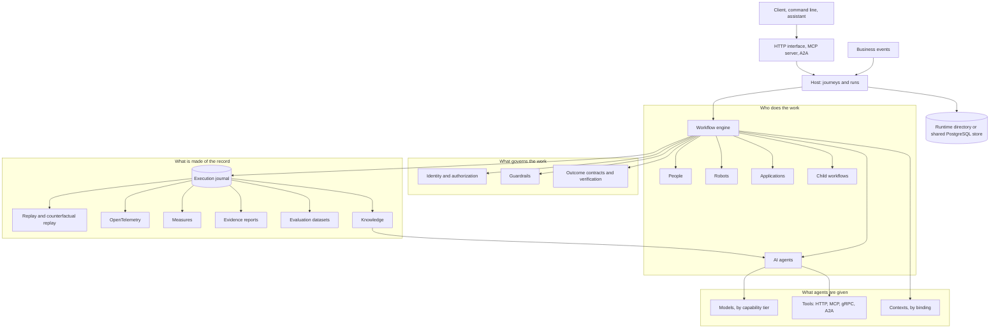

# Agentic Workflow Architecture (AWA)

AWA is an open specification for business processes in which AI agents, people, robots and applications work together. It comes with a reference implementation in TypeScript, a second implementation in Python, a Java data model, and a conformance suite that defines what it means to implement AWA.

A workflow written in AWA states what each step must achieve, who performs it, what it may reach and how its result is checked. The engine runs the workflow, records every step in a journal, and turns that journal into replays, measures, telemetry, knowledge and evidence for auditors.

---

## Why AWA

AI agents choose their own path to a result. A business needs that result to be correct, traceable and governed. AWA gives both sides what they need through one principle: **fixed outcome, free strategy**.

- The workflow fixes what must be true of each result: its schema, its postconditions, its budget and its checks.
- The agent chooses how to reach the result, with the tools and the knowledge the workflow grants it.
- The engine accepts a result once it passes the checks, records how it was reached, and hands the step to a person when the checks call for it.

The outcome is a process that uses the full capability of AI agents and that an organisation can explain, measure and audit.

---

## What AWA standardises

The specification is in [`docs/specification.md`](docs/specification.md). Each row below names the sections that define it.

### Define the work

| Layer | What it gives you | Sections |
|---|---|---|
| **Document** | A workflow is a JSON document of activities, actors, roles, edges, decision tables and events. JSON Schemas define every field. | 4, 8 |
| **Flow** | Sequences, conditional routing, parallel split and join, timers and compensation give the shape of the process. | 5, 13 |
| **Decisions** | A native decision table engine evaluates a specified entry language with strict hit policies, and decisions can feed one another. An external rule engine can take a decision where a rule base already exists. | 5.5 |
| **Model decisions** | A model can decide a decision node, choosing among the options that the workflow lists. A decision table can settle the anticipated cases first and leave the rest to the model. | 16 |
| **Contexts** | Activities share named contexts beside the data that flows. Each activity reads the contexts it is bound to read and writes the contexts it is bound to write, and the engine enforces these bindings. | 22 |
| **Sub-workflows** | An activity can run another workflow as a child run. Input and output are mapped, the child's result goes through the activity's contract and checks, and the child's waits, retries and cancellation follow the parent. | 24 |
| **Journeys** | A journey is the layer above workflows. It follows a customer or an order through stages, names the workflows that serve each stage, and records goals, exits, touchpoints, the documents that change hands, and an estimate of the customer's mood marked as measured or inferred. | 19 |

### Run the work reliably

| Layer | What it gives you | Sections |
|---|---|---|
| **Outcome contracts** | Each activity declares an output schema, postconditions, budgets and an escalation to a person. The engine checks them deterministically and accepts only the results that pass. | 7, 11 |
| **Resilience** | Retries with backoff, dead letters, checkpoints, recovery in another process and idempotency keys keep runs going through failures. | 10 |
| **Business events** | Workflows publish and wait for business events in CloudEvents form, with correlation and a deadline that leads to its own path. A run that waits for two weeks uses no resources while it waits. | 18 |
| **Service levels** | The engine compares the time that work takes, including waits and retries, with the time that was promised. It records warnings and breaches and can fail work that is still awaited. | 23 |
| **Versions in flight** | A run keeps the version of its workflow that it started on, and new runs take the newest version. An operator moves a waiting run to another version with an explicit plan. The engine checks the whole plan first, names every reason when it refuses, and records the move in the journal. | 25 |
| **Shared store** | Several hosts on several machines keep journeys and runs in one PostgreSQL database and take any work. Each event is taken exactly once, each record is complete, and the work of a host that stops is taken over by another. TypeScript and Python hosts share the same store. | 29 |

### Connect agents, models and tools

| Layer | What it gives you | Sections |
|---|---|---|
| **Model routing** | Workflows name models by capability tier, such as `tier:reasoning` or `tier:fast`. A router resolves each tier to Google, OpenAI, any open-source model server or a small model embedded in the engine, and moves to the next provider in the list when one fails. | 12 |
| **Tools** | Agents call HTTP APIs, commands, JSON-RPC, gRPC and MCP tools. Built-in executors reach MCP servers and gRPC services within the permissions of the deployment, and the journal records every call with its arguments and its result. | 17 |
| **Agents over A2A** | An agent that runs elsewhere can perform an activity over the Agent2Agent protocol 1.0, under the same contract, checks, permissions and record as any other actor. `awa serve --a2a` offers a workflow to other agents as an A2A agent. | 28 |
| **Interchange** | BPMN 2.0 and DMN documents import into AWA and export from AWA with every detail preserved. Elements that BPMN lacks travel in an `awa:` namespace, and the importer names each construct that it refuses. Workflows also export to CNCF Serverless Workflow. [`docs/interchange.md`](docs/interchange.md) compares AWA with BPMN, DMN, Serverless Workflow, Arazzo and agent frameworks. | 27 |

### Govern the work

| Layer | What it gives you | Sections |
|---|---|---|
| **Identity and authorization** | The host knows who acts. People come from the authenticated request, and agents and applications come from the deployment, each with attributes such as roles, groups or clearance. A declarative policy decides who may start a run, perform an activity, call a tool, reach an agent or complete a task. Separation of duties and four-eyes approvals are rules of their own, and an external policy engine can serve as the decider. | 30 |
| **Guardrails** | Declarative checks inspect what goes into and comes out of AI agents and tools: personal data with IBAN and card checksums, deny-lists, prompt injection markers, size, JSON Schema, allowed values, topics, and model or external classifiers. Each guardrail blocks, redacts, retries with feedback, escalates to a person or warns. The journal records where a guardrail found something and what kind of thing it found, and keeps the matched text out of the record. | 31 |
| **Evidence** | The engine computes a report for regulators and auditors from the record. The report covers what ran, which models decided what, every human decision and escalation, every check result, refusals, failures, compensations and tool calls. Every statement cites the journal records it rests on, and each part names the EU AI Act articles, NIST AI RMF functions and ISO/IEC 42001 clauses it serves. The report is evidence for the deployer's own compliance work, and [`docs/compliance/eu-ai-act.md`](docs/compliance/eu-ai-act.md) shows how to use it. | 32 |

### Learn from the record

| Layer | What it gives you | Sections |
|---|---|---|
| **Journal** | An append-only record of every run at three levels: execution, the actor's reasoning, and the engine's own decisions. | 9 |
| **Explanation** | A replay lets you step through any run, and a recipe explains how to rebuild the workflow from scratch. | 14 |
| **Counterfactual replay** | A recorded run replays under another model, prompt, contract or rule while everything else stays as recorded, and the replay produces a regression report. | 20 |
| **Measures** | 56 measures of journeys, stages, workflows and activities come from the record, each with the number of cases it was computed over: completion, where customers leave, right first time, work compared with waiting, and cost. They are also available in the OpenMetrics format. | 21 |
| **Telemetry** | Every run and every journey becomes an OpenTelemetry trace, with spans for attempts, tool calls, model calls, decisions and waits. Identifiers derive from the run, so every implementation gives the same trace for the same run. Export over OTLP runs beside the work, and inputs and outputs are included when you opt in. | 26 |
| **Knowledge** | Strategies, failure patterns and lessons are distilled from runs, reviewed by people, given back to agents, and exported as an Open Knowledge Format bundle. | 15 |
| **Evaluation** | Datasets are built from recorded runs, a candidate model or workflow is scored against them activity by activity, and shadow runs try a candidate beside production while production alone acts on the world. | 33 |

---

## Conformance

The conformance suite in [`spec/conformance`](spec/conformance) holds language-neutral cases grouped in 28 levels. An implementation claims a level when it passes every case of that level.

| Implementation | Coverage |
|---|---|
| **TypeScript** (reference) | All 28 levels. It also provides the recipe, Open Knowledge Format exchange, model providers for Google, OpenAI, Ollama and an embedded model, and the views. The shared store uses the optional package `pg`. |
| **Python** | All 28 levels, the same commands (`run`, `validate`, `journey`, `migrate`, `measures`, `replay`, `evidence`, `eval`, `knowledge`, `task`, `telemetry`, `import`, `export`, `serve`) and the same HTTP routes. Its AI agent calls models through OpenAI-compatible and Ollama providers. The shared store uses the extra `postgres`. |
| **Java** | A data model of AWA workflow and journey documents. It reads, builds and writes every example and every conformance document exactly. |

To write a new implementation, start from [`spec/conformance/README.md`](spec/conformance/README.md). The two existing test runners serve as the reference.

---

## Quick start

### TypeScript

```bash
npm install agentic-workflow-architecture
```

The following command runs a workflow in simulation. Each activity returns what the simulation file states, and the journal records the run.

```bash
npx awa run examples/claims-settlement/claims-settlement.awa.json --simulate --outputs examples/claims-settlement/simulation.json --journal run.journal.jsonl
```

The same run from code:

```typescript
import { WorkflowEngine, parse_document } from 'agentic-workflow-architecture';

const engine = new WorkflowEngine(parse_document(document), { simulate: true, simulated_outputs });
await engine.start({ claim_id: 'C-1' });
const status = await engine.run();          // completed, failed, waiting_event or waiting_human
const journal = await engine.getEvents();
```

To run with real models, list the providers in order of preference. Each tier moves to the next provider when one fails, so this run continues on a local model when the cloud model is unavailable:

```bash
npx awa run workflow.awa.json --providers google,ollama,embedded --journal run.journal.jsonl
```

| Provider | Requirement |
|---|---|
| `google` | The variable `GEMINI_API_KEY` |
| `openai` | The variable `OPENAI_API_KEY` |
| `ollama` | A running [Ollama](https://ollama.com) server, and `OLLAMA_BASE_URL` when it runs on another host |
| `embedded` | The package `@huggingface/transformers`, which runs a small open-source model inside the process |

Small embedded models follow a reply format reliably and are best suited to simple judgements. [`docs/embedded-models.md`](docs/embedded-models.md) gives measurements and advice on where to use them.

The journal of a run becomes a recipe and becomes knowledge:

```bash
npx awa recipe workflow.awa.json run.journal.jsonl -o RECIPE.md
```

```bash
npx awa knowledge ingest workflow.awa.json run.journal.jsonl
```

### Python

```bash
pip install agentic-workflow-architecture
```

The distribution is named `agentic-workflow-architecture`. The package you import and the command you run are both named `awa`. The PyPI project named `awa` belongs to another author.

```python
from awa.runtime.workflow_engine import WorkflowEngine
from awa.runtime.kpi import compute_measures
```

[`sdk/python/README.md`](sdk/python/README.md) describes the Python SDK in full.

---

## See AWA at work

**A single run.** Open [`tools/visualization/replay.html`](tools/visualization/replay.html) in a browser and pick a sample run. The [recipe](examples/claims-settlement/RECIPE.md) and the [knowledge bundle](examples/claims-settlement/knowledge/index.md) come from the same run.

**Journeys.** Open [`tools/visualization/journey.html`](tools/visualization/journey.html) to follow six customers through a year with an insurer as they buy a policy, claim on it and renew it. The view goes from an atlas of the journeys down to the workflow run behind any moment. The data comes from [`examples/claims-journey`](examples/claims-journey), and [`docs/ux/journey-visualisation-research.md`](docs/ux/journey-visualisation-research.md) explains the design of the view.

**A whole process, live.** `node examples/electricity-onboarding/demo/live.mjs` onboards a household with solar panels in about 70 seconds: agents verify documents, a grid engineer approves the export, and the journey view, the measures page and the run replay follow it as it happens ([`examples/electricity-onboarding`](examples/electricity-onboarding)). `node examples/life-insurance-savings/demo/live.mjs` follows an employee through a year of workplace pension savings with a Luxembourg life insurer, from the HR portal's invitation to the tax certificate and the annual review ([`examples/life-insurance-savings`](examples/life-insurance-savings)).

Journeys outlive the process that touches them. Each of these commands is a separate process that works on the same runtime directory:

```bash
awa journey add intake.awa.json claim.journey.json
```

```bash
awa journey publish claim.submitted -d '{"customer_id":"c-1"}'
```

```bash
awa journey list --stalled
```

```bash
awa journey export -o portfolio.json
```

**Measures.** The exported file opens in the journey view and in the measures page [`tools/visualization/dashboard.html`](tools/visualization/dashboard.html). The page shows who is waiting and who owns the next step, what became of each journey and how each workflow's runs went, and every number opens the list of customers behind it. `awa measures` prints the same measures, and `GET /api/v1/measures?format=openmetrics` gives them to a metrics system. `awa serve` with `AWA_DATA_DIR` offers everything over HTTP, and `journey.html?live=http://localhost:3000` follows the journeys as they progress.

**What-if questions.** This command shows what a recorded run would have done under a different model or rule:

```bash
awa replay workflow.awa.json run.jsonl --candidate changed.awa.json --ai recorded
```

---

## In ChatGPT, Claude, Mistral, Cursor and other assistants

[`apps/mcp-server`](apps/mcp-server) is an MCP server with embedded views (MCP Apps). In a conversation, it validates workflow and journey documents, draws a workflow as a graph with the data that moves through it, simulates and replays a run, plays business events through customer journeys, and opens the measures dashboard. The server works entirely in simulation: every tool, command, model and production system that a document names is simulated, and each call starts from a clean state.

It comes packaged for each assistant:

| Assistant | Package |
|---|---|
| Claude Code | Plugin [`plugins/awa-code`](plugins/awa-code) in this repository's marketplace: the server, the [AWA skill](skills/agentic-workflow-architecture/SKILL.md) and the `/awa:validate`, `/awa:show`, `/awa:simulate` and `/awa:example` commands |
| Claude Desktop | MCP Bundle built with `npm run bundle:mcpb`, or the configuration file |
| claude.ai, ChatGPT, Le Chat | Custom connector to the server's address (today through a tunnel) |
| Codex, ChatGPT desktop app | [`plugins/awa`](plugins/awa), the package for the ChatGPT plugin directory, in the local marketplace |
| Cursor | [`.cursor/mcp.json`](.cursor/mcp.json) and rules in this repository, an install link, and the plugin |
| Mistral Vibe, Gemini CLI | The same plugin folder, [`plugins/awa-code`](plugins/awa-code) |

**[Connect AWA to your AI assistant](docs/guides/connect-ai-assistants.md)** gives the steps for each one. In short: clone, build, then add the plugin.

```bash
cd sdk/typescript && npm ci && npm run build
```

```bash
cd apps/mcp-server && npm ci
```

In Claude Code, from the clone:

```text
/plugin marketplace add ./
/plugin install awa@agentic-workflow-architecture
```

Or straight from GitHub (Claude Code then asks for your clone's folder): `/plugin install awa --marketplace yannickhuchard/agentic-workflow-architecture`.

In Cursor, with the clone in your home folder: [](https://cursor.com/en/install-mcp?name=awa&config=eyJjb21tYW5kIjoibm9kZSIsImFyZ3MiOlsiJHt1c2VySG9tZX0vYWdlbnRpYy13b3JrZmxvdy1hcmNoaXRlY3R1cmUvcGx1Z2lucy9hd2EtY29kZS9zZXJ2ZXIvc3RhcnQubWpzIl19)

The server is not hosted yet: assistants that run in the cloud reach it through a tunnel to your computer, and one command switches every package to the hosted address when there is one. [`apps/mcp-server/SUBMISSION.md`](apps/mcp-server/SUBMISSION.md) lists the state of each package and the steps for publication: hosting, domain verification, the demo recording and the submissions.

---

## More capabilities

- **Several kinds of actor.** People, AI agents, robots and applications work in one flow, and a Kanban board presents the tasks of people.
- **Value stream analytics.** The engine computes process time, cycle time and lead time, and detects the eight DOWNTIME wastes.
- **Queryable workflows.** Code can query a workflow as a graph.
- **Operational API.** A REST server provides JWT and API key authentication, role-based access and rate limiting.
- **Diagrams.** A 2D view (ReactFlow) and a 3D view (Babylon.js) draw any workflow definition, in addition to the replay.

---

## Architecture



---

## Project structure

| Directory | Content |
|---|---|
| `docs/specification.md` | The specification |
| `spec/json-schema` | The normative JSON Schemas |
| `spec/conformance` | The language-neutral conformance cases, by level |
| `spec/` (other folders) | Informative projections: OpenAPI, GraphQL, Avro, DDL and the XSD of the `awa:` interchange namespace |
| `sdk/typescript` | The reference implementation and the `awa` command |
| `sdk/python` | The Python SDK |
| `sdk/java` | The Java data model of AWA documents |
| `sdk/javascript` | The 2D and 3D diagram library behind `tools/visualization/index.html` |
| `tools/visualization` | The run replay, the journey view and the measures page |
| `apps/mcp-server`, `plugins/awa` | The MCP server with embedded views, and its packaging as a ChatGPT plugin |
| `plugins/awa-code`, `.claude-plugin`, `.cursor-plugin`, `.cursor` | The AWA plugin for Claude Code, Cursor, Mistral Vibe and Gemini CLI, and the marketplaces that list it |
| `apps/kanban-web` | A Kanban board (Next.js) for the tasks of people |
| `examples/` | Examples, starting with `claims-settlement` and `claims-journey`; `electricity-onboarding` and `life-insurance-savings` are reference processes a utility and an insurer can plug into their own systems |
| `docs/ux` | The research behind the journey view and the measures page |

---

## Kanban web application

The Kanban board presents the tasks that running workflows give to people. Each task appears when an agent assigns it, with its context and the actor that created it.

```bash
git clone https://github.com/yannickhuchard/agentic-workflow-architecture.git
```

```bash
cd agentic-workflow-architecture/apps/kanban-web && npm install && npm run dev
```

---

## Documentation

- **[Specification](docs/specification.md)** gives the normative text.
- **[Conformance suite](spec/conformance/README.md)** explains how to test an implementation.
- **[Command line](sdk/typescript/docs/cli-guide.md)** and **[HTTP interface](sdk/typescript/docs/operational-api.md)** describe every command and route with the environment variables they read. [`spec/openapi/awa-api.yaml`](spec/openapi/awa-api.yaml) is the machine-readable API.
- **[Interchange](docs/interchange.md)** compares AWA with BPMN, DMN, Serverless Workflow, Arazzo and agent frameworks.
- **[EU AI Act guide](docs/compliance/eu-ai-act.md)** maps the obligations of the AI Act, the NIST AI RMF and ISO/IEC 42001 to the records and the evidence report, with a worked example.
- **Guides** cover [getting started](docs/getting-started.html), [developers](docs/developer-guide.html), [the data model](docs/data-model-guide.html), [process owners](docs/abpm-guide.html) and [architects](docs/architect-guide.html).
- **[Skill](skills/agentic-workflow-architecture/SKILL.md)** teaches AWA to AI coding assistants.
- **[Connect AWA to your AI assistant](docs/guides/connect-ai-assistants.md)** installs the AWA plugin and MCP server in Claude, ChatGPT, Mistral, Cursor and Gemini CLI.
- **[Examples](examples/)** start with [claims-settlement](examples/claims-settlement/) for one workflow and [claims-journey](examples/claims-journey/) for journeys. [electricity-onboarding](examples/electricity-onboarding/) is a reference example to take off the shelf: a supplier's onboarding of a household, with a sub-workflow for home generation, documented integration points, reference adapters, eight scenarios and a live demonstration. [life-insurance-savings](examples/life-insurance-savings/) is the second: a year of workplace pension savings with a fictional Luxembourg life insurer, from the HR portal to the tax return, with seven workflows, advice under the Insurance Distribution Directive, due diligence with four eyes, a right to cancel with compensation, the Art. 111bis LIR deduction as a decision table, eight scenarios and a live demonstration.
- **[Releasing](RELEASING.md)** describes how a version is published.
- **[Release notes](release_notes.md)** list every change.

---

## Governance and contributing

AWA is developed in the open, under written rules that prepare it for a neutral standards body.

- **[Governance](GOVERNANCE.md)** describes the roles, how decisions are made, how the specification changes and how an implementation claims conformance.
- **[AWA Enhancement Proposals](docs/proposals/README.md)** record every normative change with its reasons, its rules and its conformance cases.
- **[Contributing](CONTRIBUTING.md)** explains how to propose a change, set up the SDKs and run the checks.
- **[Roadmap](ROADMAP.md)** lists the steps from version 2.0.0 to an international standard.
- **[Code of Conduct](CODE_OF_CONDUCT.md)** and **[Security policy](SECURITY.md)** apply to every participant and every report.
- **[Maintainers](MAINTAINERS.md)** lists who reviews and merges changes.

---

## License

AWA is released under the Apache License 2.0.

## Authors

- [Yannick HUCHARD](https://yannickhuchard.com)
