# AWA Entity-Relationship Model

> Agentic Workflow Architecture — Data Model  
> Author: Yannick HUCHARD  
> Version: 1.1.0  
> Last Updated: 2026-04-17

---

## Entity-Relationship Diagram

```mermaid
erDiagram
    WORKFLOW {
        uuid id PK
        string name
        string version
        string description
        uuid owner_id FK
        uuid organization_id FK
        uuid parent_workflow_id FK
        uuid expansion_activity_id FK
        datetime_tz created_at
        datetime_tz updated_at
    }

    ACTIVITY {
        uuid id PK
        string name
        string description
        uuid role_id FK
        enum actor_type "human | ai_agent | robot | application"
        uuid system_id FK
        uuid machine_id FK
        uuid endpoint_id FK
        uuid organization_id FK
        boolean is_expandable
        uuid expansion_workflow_id FK
    }

    EDGE {
        uuid id PK
        uuid source_id FK
        uuid target_id FK
        enum source_type "activity | event | decision"
        enum target_type "activity | event | decision"
        string condition
        string label
        boolean is_default
    }

    EVENT {
        uuid id PK
        string name
        string description
        string event_type
        json event_definition
    }

    DECISION_NODE {
        uuid id PK
        string name
        string description
        uuid default_output_edge_id FK
    }

    DECISION_TABLE {
        enum hit_policy "unique | first | priority | any | collect | rule_order"
    }

    TABLE_COLUMN {
        string name
        string label
        enum type "string | number | boolean | date | datetime"
        json allowed_values
    }

    DECISION_RULE {
        uuid id PK
        string description
        json input_entries
        json output_entries
        uuid output_edge_id FK
    }

    CONTEXT {
        uuid id PK
        string name
        string description
        enum type "document | data | config | state | memory | artifact"
        json schema
        json initial_value
        enum sync_pattern "shared_state | message_passing | blackboard | event_sourcing"
        enum visibility "private | workflow | collection | global"
        uuid owner_workflow_id FK
        enum lifecycle "transient | persistent | cached"
        duration ttl
    }

    CONTEXT_BINDING {
        uuid id PK
        uuid context_id FK
        uuid activity_id FK
        enum access_mode "read | write | read_write | subscribe | publish"
        boolean required
        string on_read_transform
        string on_write_transform
    }

    ACCESS_RIGHT {
        uuid id PK
        string name
        string description
        uuid activity_id FK
        enum direction "requires | provisions"
        enum resource_type "system | api | database | file | service | secret"
        string resource_id
        enum permission "read | write | execute | admin | delete | create"
        string scope
        json conditions
    }

    ROLE {
        uuid id PK
        string name
        string description
        enum actor_type "human | ai_agent | robot | application"
        uuid organization_id FK
        json capabilities
        boolean is_embedded
    }

    AI_MODEL_CONFIG {
        string model_id
        float temperature
        int max_tokens
        string system_prompt
    }

    MCP_TOOL {
        string server_name
        string tool_name
    }

    SYSTEM {
        uuid id PK
        string name
        string vendor
        string version
        enum type "erp | crm | hrm | scm | custom | saas | database | messaging | storage"
        string description
        string base_url
        json auth_config
    }

    MACHINE {
        uuid id PK
        string name
        enum type "robot | sensor | actuator | printer | scanner | vehicle | camera | conveyor"
        string manufacturer
        string model
        string serial_number
        string location
        enum protocol "mqtt | opcua | modbus | http | grpc | ros"
        string connection_string
    }

    ENDPOINT {
        uuid id PK
        string name
        string url
        enum method "GET | POST | PUT | DELETE | PATCH | GRPC | WEBSOCKET | GRAPHQL"
        enum auth_type "none | api_key | oauth2 | jwt | basic | mtls"
        string openapi_ref
        json request_schema
        json response_schema
    }

    PROGRAM {
        uuid id PK
        string name
        enum language "python | typescript | javascript | java | sql | mcp_tool | rest_api | graphql | shell"
        string code
        string code_uri
        string mcp_server
    }

    PARAMETER {
        string name
        string type
        boolean required
        json default_value
    }

    CONTROL {
        uuid id PK
        string name
        string description
        enum type "authorization | validation | audit | compliance | security | rate_limit"
        string expression
        enum enforcement "mandatory | advisory | informational"
    }

    SLA {
        uuid id PK
        string name
        duration target_time
        duration max_time
    }

    SLA_METRIC {
        string name
        float target
        string unit
        enum comparison "lt | lte | eq | gte | gt"
    }

    ANALYTICS {
        duration process_time
        duration cycle_time
        duration lead_time
        duration wait_time
        boolean value_added
        float resource_utilization
        float error_rate
        float process_cycle_efficiency
    }

    WASTE_CATEGORY {
        enum category "defects | overproduction | waiting | non_utilized_talent | transport | inventory | motion | extra_processing"
    }

    COST {
        float amount
        string currency
    }

    THROUGHPUT {
        float value
        string unit
        duration period
    }

    SKILL_BINDING {
        uuid id PK
        string name
        enum type "ai_context | human_competency"
        string description
        string min_level
        string reference
    }

    TOOL_REQUIREMENT {
        uuid id PK
        string name
        enum type "mcp | rest_api | graphql | grpc | software_package | hardware_interface"
        string description
        string version
        string reference
    }

    DATA_OBJECT {
        string name
        string description
        json schema
        boolean required
    }

    COLLECTION {
        uuid id PK
        string name
        string description
        uuid owner_id FK
        uuid organization_id FK
        json tags
        datetime_tz created_at
        datetime_tz updated_at
    }

    HUMAN_TASK {
        uuid id PK
        uuid activity_id FK
        string activity_name
        uuid token_id FK
        uuid workflow_id FK
        enum status "pending | assigned | in_progress | completed | rejected | expired"
        enum priority "low | normal | high | critical"
        string assignee_id
        uuid role_id FK
        string creator_id
        enum creator_type "human | ai_agent | robot | application"
        string assigner_id
        enum assigner_type "human | ai_agent | robot | application"
        json inputs
        json outputs
        datetime_tz created_at
        datetime_tz updated_at
        datetime_tz due_at
        datetime_tz completed_at
        string description
        json form_schema
        json tags
    }

    WORKFLOW_EXECUTION {
        uuid id PK
        uuid workflow_id FK
        string workflow_name
        enum status "completed | failed"
        datetime_tz started_at
        datetime_tz completed_at
        int duration_ms
        int input_tokens
        int output_tokens
        int total_tokens
        float execution_cost
        string currency
        int steps_count
        string user_id
        json metadata
    }

    VERIFICATION_POLICY {
        boolean enabled
        enum mode "ai_judge | schema_only | custom"
        int max_retries
        boolean retry_with_feedback
        json output_schema
        string judge_model_id
        float judge_temperature
        float pass_threshold
    }

    VERIFICATION_CRITERION {
        uuid id PK
        string name
        string description
        enum type "completeness | accuracy | format | compliance | custom"
        string expression
        float weight
        boolean required
    }

    VERIFICATION_RECORD {
        uuid id PK
        uuid activity_id FK
        int attempt
        enum verdict "pass | fail | error"
        float overall_score
        string feedback
        datetime_tz verified_at
        int duration_ms
        int judge_input_tokens
        int judge_output_tokens
        string output_hash
    }

    VERIFICATION_CRITERION_RESULT {
        uuid criterion_id FK
        string criterion_name
        boolean passed
        string evidence
        float confidence
    }

    %% ==========================================
    %% RELATIONSHIPS
    %% ==========================================

    WORKFLOW ||--o{ ACTIVITY : "contains"
    WORKFLOW ||--o{ EDGE : "contains"
    WORKFLOW ||--o{ EVENT : "contains"
    WORKFLOW ||--o{ DECISION_NODE : "contains"
    WORKFLOW ||--o{ CONTEXT : "owns"
    WORKFLOW ||--o| SLA : "has"
    WORKFLOW ||--o| ANALYTICS : "has"
    WORKFLOW }o--o| WORKFLOW : "parent_workflow"

    COLLECTION ||--o{ WORKFLOW : "groups"
    COLLECTION ||--o{ CONTEXT : "shares"

    ACTIVITY ||--o{ CONTEXT_BINDING : "binds"
    ACTIVITY ||--o{ ACCESS_RIGHT : "declares"
    ACTIVITY ||--o{ PROGRAM : "executes"
    ACTIVITY ||--o{ CONTROL : "enforces"
    ACTIVITY ||--o{ SKILL_BINDING : "requires"
    ACTIVITY ||--o{ TOOL_REQUIREMENT : "needs"
    ACTIVITY ||--o{ DATA_OBJECT : "inputs"
    ACTIVITY ||--o{ DATA_OBJECT : "outputs"
    ACTIVITY ||--o| SLA : "has"
    ACTIVITY ||--o| ANALYTICS : "has"
    ACTIVITY }o--|| ROLE : "performed_by"
    ACTIVITY }o--o| SYSTEM : "uses"
    ACTIVITY }o--o| MACHINE : "operates"
    ACTIVITY }o--o| ENDPOINT : "calls"

    EDGE ||--o{ SKILL_BINDING : "requires"
    EDGE ||--o{ TOOL_REQUIREMENT : "needs"

    CONTEXT_BINDING }o--|| CONTEXT : "references"

    DECISION_NODE ||--|| DECISION_TABLE : "defines"
    DECISION_TABLE ||--|{ TABLE_COLUMN : "input_columns"
    DECISION_TABLE ||--|{ TABLE_COLUMN : "output_columns"
    DECISION_TABLE ||--o{ DECISION_RULE : "has_rules"

    ROLE ||--o| AI_MODEL_CONFIG : "configures"
    ROLE ||--o{ MCP_TOOL : "uses"

    PROGRAM ||--o{ PARAMETER : "accepts"

    SLA ||--o{ SLA_METRIC : "defines"

    ANALYTICS ||--o{ WASTE_CATEGORY : "flags"
    ANALYTICS ||--o| COST : "tracks"
    ANALYTICS ||--o| THROUGHPUT : "measures"

    HUMAN_TASK }o--|| WORKFLOW : "belongs_to"
    HUMAN_TASK }o--|| ACTIVITY : "for"
    HUMAN_TASK }o--|| ROLE : "assigned_to"

    WORKFLOW_EXECUTION }o--|| WORKFLOW : "records"

    ACTIVITY ||--o| VERIFICATION_POLICY : "verified_by"
    VERIFICATION_POLICY ||--|{ VERIFICATION_CRITERION : "defines"
    VERIFICATION_RECORD }o--|| ACTIVITY : "verifies"
    VERIFICATION_RECORD ||--o{ VERIFICATION_CRITERION_RESULT : "contains"
```

---

## Entity Summary

| Entity | Description | Key Relationships |
|--------|-------------|-------------------|
| **Workflow** | Top-level directed graph of activities | Contains Activities, Edges, Events, Decisions, Contexts |
| **Activity** | Unit of work performed by an actor | Bound to Role, System, Machine, Endpoint |
| **Edge** | Connection between graph nodes | Links Activities, Events, Decision Nodes |
| **Context** | Shared state for multi-agent collaboration | Bound to Activities via Context Bindings |
| **Decision Node** | DMN-inspired routing logic | Contains Decision Table with Rules |
| **Role** | Actor definition with capabilities | Optionally includes AI Model Config + MCP Tools |
| **Collection** | Grouping of related workflows | Shares Contexts across workflows |
| **Human Task** | Persistent task for human-in-the-loop | References Workflow, Activity, Role |
| **Workflow Execution** | Runtime metrics and cost tracking | References Workflow |
| **Verification Policy** | Acceptance criteria for activity outputs | Attached to Activity, contains Criteria |
| **Verification Criterion** | Single testable acceptance condition | Defined by Verification Policy |
| **Verification Record** | Provable evidence of verification result | References Activity, contains Criterion Results |

---

## Notes

- All entities use **UUID** as primary key (DM-006)
- All timestamps use **Datetime with Timezone** (DM-005)
- The ER model is the single source of truth for the data architecture
- Serialization formats: JSON Schema, Avro, OpenAPI 3.1, GraphQL, PostgreSQL DDL (see `spec/`)
