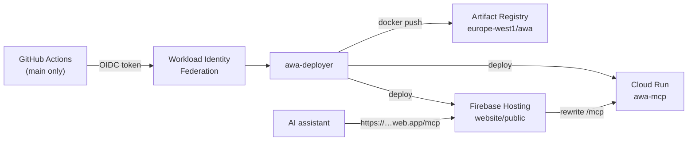

# Deploying the MCP server and the website

The AWA MCP server runs on Cloud Run in the Firebase project `agentic-workflow-architecture`, region `europe-west1`. Firebase Hosting serves the website and forwards `/mcp` to the server, so the public address is:

```text
https://agentic-workflow-architecture.web.app/mcp
```

GitHub Actions deploys it ([`.github/workflows/deploy-mcp.yml`](../.github/workflows/deploy-mcp.yml)) on every push to `main` that touches the server, the SDK, the views, the claims example or the website, and on demand. It signs in to Google Cloud through Workload Identity Federation, so no key is stored anywhere.



## One-time setup

1. **Put the project on the Blaze plan.** Cloud Run needs a billing account. In the [Firebase console](https://console.firebase.google.com/project/agentic-workflow-architecture/usage/details), choose Upgrade. The server scales to zero, so it costs nothing while nobody calls it.
2. **Open Hosting once.** In the Firebase console, open Build, then Hosting, then Get started, and follow the screens to the end. This creates the default site `agentic-workflow-architecture`. You do not need to run the commands it shows.
3. **Run the setup script in Cloud Shell.** Open [Cloud Shell](https://shell.cloud.google.com) as an owner of the project, then:

   ```bash
   git clone https://github.com/yannickhuchard/agentic-workflow-architecture && cd agentic-workflow-architecture
   ```

   ```bash
   bash deploy/gcp-setup.sh
   ```

   It enables the APIs, creates the image registry and the account `awa-deployer` with the roles it needs, and lets this repository's workflows on `main`, and nothing else, act as that account. It is safe to run again.
4. **Set the two repository variables it prints.** In GitHub, open Settings, then Secrets and variables, then Actions, then Variables: `GCP_WORKLOAD_IDENTITY_PROVIDER` and `GCP_SERVICE_ACCOUNT`. They are identifiers, not secrets. The script also prints the `gh variable set` commands.
5. **Run the workflow.** In the Actions tab, choose "Deploy the MCP server", then Run workflow. It builds the image, runs it on Cloud Run, deploys Hosting, and checks that the server lists its tools at both addresses.

## After the first deployment

Point every plugin package at the hosted address, in one step, from `apps/mcp-server`:

```bash
npm run hosted:set -- https://agentic-workflow-architecture.web.app/mcp
```

Assistants that run in the cloud (claude.ai, ChatGPT, Le Chat) can then add the address as a custom connector without a tunnel. [`docs/guides/connect-ai-assistants.md`](../docs/guides/connect-ai-assistants.md) gives the steps.

## What runs

| Setting | Value | Why |
|---|---|---|
| Image | `apps/mcp-server/Dockerfile`, built from the repository root | The server reads the SDK, the views and the claims example |
| `AWA_MCP_PUBLIC_URL` | `https://agentic-workflow-architecture.web.app/mcp` | Public mode: the server answers only its own host names |
| `AWA_MCP_ALLOWED_HOSTS` | The Cloud Run addresses of the service | Firebase Hosting and direct calls reach the service by those names |
| Instances | 0 to 10, 8 requests at once each, 1 CPU, 1 GiB | The server is stateless and answers in JSON, without streaming. Cloud Run's concurrency equals the server's own limit (`AWA_MCP_MAX_CONCURRENT`), so a request Cloud Run accepts is never refused by the server |
| Access | Public, no authentication | Every tool is read-only and runs in simulation |

## Checking the image locally

```bash
docker build -f apps/mcp-server/Dockerfile -t awa-mcp .
```

```bash
docker run --rm -p 8080:8080 -e AWA_MCP_PUBLIC_URL=https://agentic-workflow-architecture.web.app/mcp awa-mcp
```

```bash
curl -s -X POST http://127.0.0.1:8080/mcp -H 'Host: agentic-workflow-architecture.web.app' -H 'Content-Type: application/json' -H 'Accept: application/json, text/event-stream' -d '{"jsonrpc":"2.0","id":1,"method":"tools/list"}'
```
