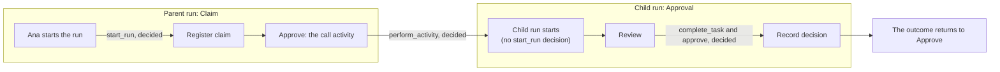

# AEP 0003: Starting a child run is part of its call activity

| Field | Value |
|---|---|
| Status | `implemented` |
| Author | Yannick HUCHARD |
| Created | 2026-11-27 |
| Specification version | 1.1 |
| Sections | 24.2, 30.4, 30.6 |
| Conformance level | `subworkflows`, `authorization` |

## Decision

| | |
|---|---|
| **Decision** | Under a policy, starting a child run is part of performing its call activity. The call activity is decided as `perform_activity`; the child run is not decided as `start_run`. Every activity inside the child is decided as in any run. |
| **Chosen because** | One decision governs one step. A policy author grants each workflow once, and a call to a sub-workflow keeps working when the policy grants the call activity. |
| **Cost** | A policy cannot forbid one workflow from being started through a call while allowing the call activity. Section "Evolution" below gives the way to add that control later. |
| **Alternatives** | Deciding `start_run` for every child run, as the principal who started the root, or as the host. |

## Problem

When the workflow "Claim" calls the workflow "Approval", the engine starts a child run. Section 30 decides who may start a run (`start_run`) and who may perform an activity (`perform_activity`). A child run sits on both: it is a run, and it is how the parent performs one of its activities. The specification has to say which decision applies.

The integration review of version 1.1 found the cost of the second reading. The first implementation decided `start_run` for each child run: a policy that allowed people to start "Claim" refused every "Approval" child with `FORBIDDEN`, and every claim failed.

## Proposal

- The parent's call activity is decided as `perform_activity`, as any activity is.
- The child run starts without a `start_run` decision.
- The child's `run.started` names as `principal` whoever started the run of depth 0, so the record says on whose behalf the child runs.
- Every activity of the child is decided as in any run, and a person's answer to a task of the child is decided in the child, for that person.
- Separation of duties and four-eyes rules treat the run of depth 0 and all of its child runs as one record (30.6): the person who submitted in the parent cannot approve in the child.

Figure 24-1 of the specification shows the same sequence.

## Why this is safe

The design adds no path around the policy:

1. Someone must be allowed to start the root run (`start_run`).
2. The call activity must be allowed (`perform_activity`).
3. Each activity inside the child is decided, with the same principals and the same rules.
4. Separation of duties spans the parent and the child, so splitting a decision into a sub-workflow does not escape it.

## Effect on existing documents

Every existing document keeps its meaning. A policy written for version 1.1 needs no rule for the workflows that are only called.

## Alternatives considered

- **Decide `start_run` for every child run, as the root's starter.** Each policy then lists every called workflow, and a policy that forgets one breaks every run that calls it. The control it adds is rarely needed, since the call activity is already decided.
- **Decide `start_run` for every child run, as the host.** The host would pass for the person, which hides who acted. The integration review rejected this reading for that reason.

## Evolution

A deployment that needs to control which workflows may be called can gain an opt-in setting in a later version, for example `authorization.decide_child_starts: true`, under which each child run is decided as `start_run` for the root's starter. That change would come as its own proposal, with its conformance cases, and the default would stay as this proposal sets it.

## Implementation notes

Both SDKs follow this rule (`sdk/typescript/src/runtime/workflow_engine.ts`, `sdk/python/awa/runtime/workflow_engine.py`), and `tests/seams.test.ts` and `tests/test_seams.py` hold the tests that fixed it.
