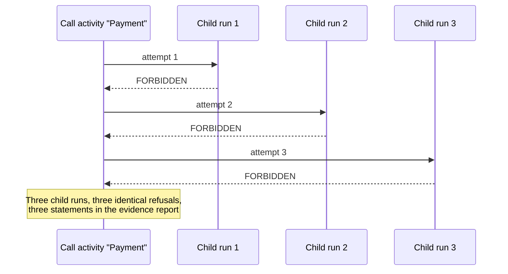
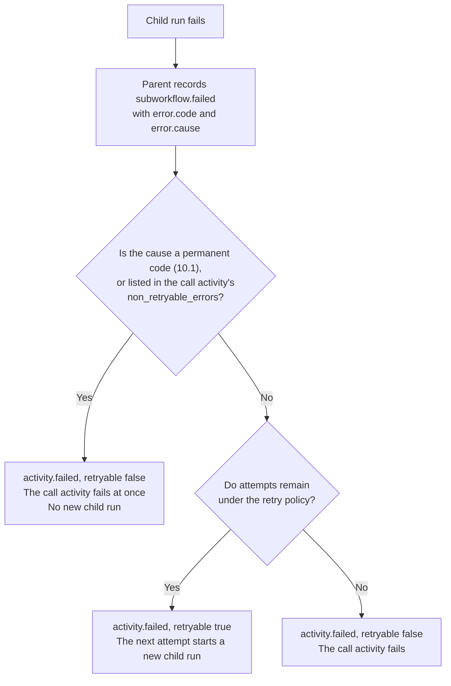

# AEP 0004: A child run that failed for a permanent cause is not started again

| Field | Value |
|---|---|
| Status | `implemented` |
| Author | Yannick HUCHARD |
| Created | 2026-11-27 |
| Specification version | 1.1 |
| Sections | 9.3, 10.1, 24.3 |
| Conformance level | `subworkflows` |

## Decision

| | |
|---|---|
| **Decision** | A child run's failure carries its **cause**: the code of the first failure at the deepest level. When the cause is a permanent code, or a code the call activity's `non_retryable_errors` lists, the call activity fails at once and starts no other child run. |
| **Chosen because** | A refusal by the policy, a guardrail block or a missing workflow repeats identically on every attempt. Retrying it wastes runs and fills the record with copies of the same refusal. |
| **Cost** | A call activity whose child was refused fails sooner than before. Journals gain the field `error.cause`, which readers that ignore unknown fields leave aside. |
| **Alternatives** | Keep retrying every `SUBWORKFLOW_FAILED`; give the call activity the child's own code; let each workflow list the causes to stop on. |

## Problem

Until this proposal, a call activity failed with `SUBWORKFLOW_FAILED` whatever made its child run fail, and `SUBWORKFLOW_FAILED` was retried under the activity's retry policy. A child refused by the policy (`FORBIDDEN`) or blocked by a guardrail (`GUARDRAIL_BLOCKED`) was therefore started again, refused again, and started again, until the attempts ran out:

## Proposal

1. **The cause.** The cause of a child run's failure is the code of its first failure. When that failure is itself a `SUBWORKFLOW_FAILED`, the cause is the cause it carries. The cause is therefore always the code of the first failure at the deepest level: a grandchild's `GUARDRAIL_BLOCKED` reaches the root as `GUARDRAIL_BLOCKED`.
2. **The record.** The engine records the cause as `error.cause` in `subworkflow.failed` (when it differs from `error.code`), in the call activity's `activity.failed`, and in `token.failed`. The code stays `SUBWORKFLOW_FAILED`, so that every reader that matched on it keeps working.
3. **The rule.** A cause that is a permanent code (the table of 10.1), or a code that the call activity's `non_retryable_errors` lists, makes the attempt not retryable. Any other cause is retried as before.
4. **The permanent codes in one place.** Section 10.1 now lists every code that the engine never retries, with the section that defines it, instead of leaving each rule in its own section.

## Normative text

The text is in the specification: the table of permanent codes in 10.1, the paragraph "Failed" of 24.3 with Figure 24-2, and the field `error.cause` of `activity.failed` in 9.3.

## Conformance cases

| Case | What it shows |
|---|---|
| `subworkflow-permanent-cause-is-not-retried` | A child refused with `FORBIDDEN`: one child run, the call activity fails with the cause `FORBIDDEN`, no retry |
| `subworkflow-cause-named-by-the-retry-policy-is-not-retried` | A child that fails with a business code the call activity lists in `non_retryable_errors`: no retry |
| `subworkflow-transient-cause-is-retried-with-its-cause` | A child that times out: retried as before, with the cause `TIMEOUT` on record |
| `subworkflow-cause-comes-from-the-deepest-run` | A grandchild blocked by a guardrail: neither the child's call activity nor the root's is retried, and both name `GUARDRAIL_BLOCKED` |

Both SDKs pass the four cases. With the rule removed, the three cases of permanent causes fail in both SDKs.

## Effect on existing documents

Every document stays valid. One behaviour changes: a call activity whose child failed for a permanent cause fails at its first attempt instead of after its last. The specification is in draft and SDK 2.0.0 is not yet published, so the change enters version 1.1 directly, listed in Appendix B and in the release notes.

## Alternatives considered

- **Keep retrying every `SUBWORKFLOW_FAILED`.** This is the problem the proposal solves.
- **Give the call activity the child's own code.** The parent would fail with `FORBIDDEN` instead of `SUBWORKFLOW_FAILED`. Readers could then no longer tell a refusal of the parent from a refusal inside its child, and every reader that matched on `SUBWORKFLOW_FAILED` would change. The cause gives the same information and keeps the code.
- **Let each workflow list the causes to stop on.** The permanent codes are permanent by their nature, so each workflow would repeat the same list. The proposal fixes them once and keeps `non_retryable_errors` for the codes a workflow adds.

## Evolution strategy

The proposal is the first step of a plan that makes retries predictable across every kind of actor.

| Step | Version | What changes | Compatibility |
|---|---|---|---|
| **1. Permanent causes** (this proposal) | 1.1 | The cause travels up from child runs; the permanent codes are listed once in 10.1; a permanent cause is not retried | Documents unchanged; a call activity refused permanently fails sooner; journals gain `error.cause` |
| **2. Error classes** | 1.2 | Every code of the specification belongs to a class: `transient` (a timeout, a service that is unavailable), `permanent` (the table of 10.1) or `judged` (a rejected outcome). Tools, A2A agents, MCP and gRPC executors report the class of their failures, and a retry policy can name the classes it retries | A minor version: the classes describe the current rules, and a policy that names no class behaves as today |
| **3. A retry budget across levels** | 1.2 or 1.3 | A run of depth 0 can carry a total budget of attempts for itself and its children, so that nested retry policies do not multiply (three attempts at each of three levels are 27 attempts today) | A new optional field; without it, each level keeps its own policy |
| **4. Circuit breaking** | Later | A host stops calling a tool or an agent that keeps failing for a transient cause, for a declared time, and records that it did | A new optional deployment setting |

Each later step is its own proposal, with its conformance cases and two implementations, under [`GOVERNANCE.md`](../../GOVERNANCE.md).

## Implementation notes

- TypeScript: `sdk/typescript/src/runtime/subworkflow.ts` computes the cause, and `sdk/typescript/src/runtime/workflow_engine.ts` exports `PERMANENT_ERRORS` and applies the rule.
- Python: `sdk/python/awa/runtime/subworkflow.py` and `sdk/python/awa/runtime/workflow_engine.py`, with the same set.
- The cause is kept in the failed token's data as `_error_cause`, so that a grandparent reads it from its child's failed token.
