# Recipe: Motor Claim Settlement

Workflow version 1.0.0, AWA specification 1.1.
Compiled from run `1c5f2824-ac15-4cf1-b6f6-385bb4201253`, which completed in 6.4 s. The journal holds 65 events.

This document explains how to build this workflow from scratch and what one real run of it did. Sections 2 to 4 are the build instructions. Section 5 is what the run taught. Section 6 is how to check your build.

## 1. What this workflow achieves

Settles a motor insurance claim: registers it, has an AI agent assess the damage under an outcome contract, checks fraud signals and policy cover in parallel, routes by risk, and pays the claimant. Funds reserved for a payment that later fails are released.

| In this run | |
|---|---|
| Outcome | completed |
| Duration | 6.4 s |
| Activities accepted | 8 |
| Attempts made | 10 (2 rejected or errored) |
| Model tokens | 3580 in, 515 out |
| Cost | EUR 0.0235 |

## 2. What you need before you start

### Actors

| Role | Actor type | Performs | Notes |
|---|---|---|---|
| Claims system | application | Register claim, Consolidate findings | The system of record for claims |
| Damage assessor | ai_agent | Assess damage | Estimates repair costs from descriptions and photos. model `tier:reasoning`. capabilities: damage assessment, repair pricing |
| Fraud analyst | ai_agent | Check fraud signals | Scores claims for fraud indicators. model `tier:fast`. capabilities: fraud scoring |
| Policy system | application | Verify policy cover | Holds policies and their cover |
| Claims adjuster | human | Adjuster review | Decides claims above the automatic limit |
| Fraud investigator | human | Investigate | Investigates suspected fraud |
| Finance system | application | Reserve funds, Pay claimant, Release funds | Reserves and pays funds |
| Customer communications | ai_agent | Notify claimant | Writes to claimants. model `tier:balanced`. capabilities: customer writing |

### Models

Map each reference to a model of similar capability in your deployment.

| Used by | Reference in the document | Resolved to in this run |
|---|---|---|
| Assess damage | `tier:reasoning` | `acme:assessor-large`, temperature 0.2 |
| Check fraud signals | `tier:fast` | `acme:classifier-small`, temperature 0.2 |
| Notify claimant | `tier:balanced` | `acme:writer-medium`, temperature 0.2 |

### Callable tools

Each tool an actor may call, and what it runs. Provide every target before running the workflow.

| Activity | Tool | Runs | What it does |
|---|---|---|---|
| Assess damage | `price_part` | HTTP GET https://repair-catalogue.example/v2/parts/{part}/price | Price of a replacement part, with fitting, from the repair catalogue. ([docs](https://repair-catalogue.example/openapi.json)) |
| Verify policy cover | `get_policy` | HTTP GET https://policies.example/api/policies/{policy_number} | The policy's status, cover and excess. |
| Pay claimant | `transfer` | JSON-RPC payments.transfer at https://payments.example/rpc | Transfer money to the claimant's account. |

### Engine

An AWA engine that claims these conformance levels: `document`, `core`, `decision`, `model-decision`, `tools`, `verified`, `resilient`, `contract`, `flow`.

## 3. Build it, step by step

Steps are in the order this run reached them. Steps the run did not reach follow, marked as such.

### Step 1: Register claim

- **Kind**: activity, performed by `application`, role Claims system
- **Purpose**: Create the claim record and attach the policy number.
- **On error**: up to 3 attempts, first delay PT0.2S
- **Then**:
  - always: go to **Assess damage** (taken in this run)

**In this run**

- Attempt 1: accepted (the activity took 252 ms in all)

Accepted outcome:

```json
{
  "claim_id": "CLM-2041",
  "policy_number": "POL-77310"
}
```

### Step 2: Assess damage

- **Kind**: activity, performed by `ai_agent`, role Damage assessor
- **Purpose**: Estimate the repair cost and severity from the claim description and photos.
- **Procedure**: Read the claim description. Identify each damaged part. Price parts and labour from the repair catalogue. State the severity.
- **Tools it may call**: `price_part` (HTTP GET https://repair-catalogue.example/v2/parts/{part}/price)
- **Must produce** (outcome contract):
  - an outcome matching this schema:
    - `estimated_cost`: number, required, minimum 0. Repair cost in EUR
    - `severity`: string, required, enum ["minor","moderate","severe","total_loss"]
    - `summary`: string, required, minLength 20
  - Within authority: `estimated_cost <= 50000`
  - budget: at most 3 attempts, each attempt within PT30S, at most 20000 model tokens
  - if the outcome is still rejected: hand it to a human
- **Acceptance criteria** (verification by `schema_only`, pass at 90%, up to 1 retry):
  - Parts itemised (required): The assessment lists the damaged parts. Checked as `parts exists`.
- **Then** (in parallel):
  - always: go to **Check fraud signals** (taken in this run)
  - always: go to **Verify policy cover** (taken in this run)

**In this run**

- Attempt 1: rejected: Outcome contract violated: /estimated_cost must be number; Within authority: "estimated_cost <= 50000" does not hold
  - Model: Use model acme:assessor-large. The role assigned to this activity names this model. The reference is the capability tier "reasoning", which this deployment maps to that model.
  - Plan the actor reported: Read the claim description → List damaged parts → Estimate the cost
  - Rationale: Rear-end collision at low speed; the damage is limited to the bumper and tailgate.
  - Alternatives it rejected: Total loss: rejected, the chassis is intact
  - Confidence it reported: 0.6
  - Contract: violated (/estimated_cost must be number; Within authority: "estimated_cost <= 50000" does not hold)
  - Engine decision (contract_retry): Re-execute with the violated contract terms as feedback. 2 contract term(s) did not hold and 2 of 3 attempts remained.
- Attempt 2: accepted (the activity took 2.0 s in all)
  - Model: Use model acme:assessor-large. The role assigned to this activity names this model. The reference is the capability tier "reasoning", which this deployment maps to that model.
  - Plan the actor reported: Re-read the contract feedback → Price each part from the repair catalogue → Sum parts and labour → Return the cost as a number
  - Rationale: The first answer gave the cost as text. Itemising the parts gives a numeric total of 3,200 EUR and satisfies the schema.
  - Alternatives it rejected: Repair rather than replace the tailgate: rejected, the crease runs through the lock housing
  - Confidence it reported: 0.86
  - Tool call at 2026-11-22T11:23:18.270Z: `price_part` → https://repair-catalogue.example/v2/parts/rear%20bumper/price (http), returned 200 in 170 ms. Arguments: `{"part":"rear bumper","vehicle":"2021 hatchback"}`
  - Tool call at 2026-11-22T11:23:18.270Z: `price_part` → https://repair-catalogue.example/v2/parts/tailgate/price (http), returned 200 in 150 ms. Arguments: `{"part":"tailgate","vehicle":"2021 hatchback"}`
  - Contract: held
  - Verification: pass, score 100%
    - met: Parts itemised. Expression "parts exists" evaluated to true

Accepted outcome:

```json
{
  "estimated_cost": 3200,
  "severity": "moderate",
  "summary": "Low-speed rear-end collision. Rear bumper and tailgate need replacing; no structural damage.",
  "parts": [
    {
      "part": "rear bumper",
      "cost": 1150
    },
    {
      "part": "tailgate",
      "cost": 1400
    },
    {
      "part": "labour and paint",
      "cost": 650
    }
  ]
}
```

### Step 3: Check fraud signals

- **Kind**: activity, performed by `ai_agent`, role Fraud analyst
- **Purpose**: Score the claim for fraud indicators.
- **Must produce** (outcome contract):
  - Score is a probability: `fraud_score >= 0 && fraud_score <= 1`
  - if the outcome is still rejected: fail the activity
- **On error**: up to 3 attempts, first delay PT0.3S
- **Then**:
  - always: go to **Consolidate findings** (taken in this run)

**In this run**

- Attempt 1: errored: Fraud scoring service timed out
  - Engine decision (retry): Retry after 250 ms. Attempt 1 raised "Fraud scoring service timed out" (TIMEOUT). The error is retryable and 2 of 2 retries remained.
- Attempt 2: accepted (the activity took 1.5 s in all)
  - Model: Use model acme:classifier-small. The role assigned to this activity names this model. The reference is the capability tier "fast", which this deployment maps to that model.
  - Plan the actor reported: Compare claim date with policy start → Check prior claims → Check repairer against watchlist
  - Rationale: Policy held for four years, one prior claim, repairer not on the watchlist.
  - Confidence it reported: 0.9
  - Contract: held

Accepted outcome:

```json
{
  "fraud_score": 0.12,
  "signals": []
}
```

### Step 4: Verify policy cover

- **Kind**: activity, performed by `application`, role Policy system
- **Purpose**: Confirm the policy was in force and covers this kind of damage.
- **Tools it may call**: `get_policy` (HTTP GET https://policies.example/api/policies/{policy_number})
- **Then**:
  - always: go to **Consolidate findings** (taken in this run)

**In this run**

- Attempt 1: accepted (the activity took 353 ms in all)
  - Tool call at 2026-11-22T11:23:19.025Z: `get_policy` → https://policies.example/api/policies/POL-77310 (http), returned 200 in 153 ms. Arguments: `{"policy_number":"POL-77310"}`

Accepted outcome:

```json
{
  "cover_confirmed": true,
  "excess": 250
}
```

### Step 5: Consolidate findings

- **Kind**: activity, performed by `application`, role Claims system
- **Purpose**: Combine the assessment, the fraud score and the cover check into one case file.
- **Join**: waits for a token on every incoming edge, then runs once with their merged data
- **Then**:
  - always: go to **Settlement route** (taken in this run)

**In this run**

- Attempt 1: accepted (the activity took 202 ms in all)

Accepted outcome:

```json
{
  "settlement_amount": 2950,
  "estimated_cost": 3200
}
```

### Step 6: Settlement route

- **Kind**: decision, decided by a decision table first, and by a model when no rule matches
- **Purpose**: Choose how the claim is settled. Clear cases are decided by the table; the rest by a model, within three options.

| # | Fraud score | Estimated cost | route | Go to |
|---|---|---|---|---|
| 1 | `>= 0.7` | `-` | "investigate" | Investigate |
| 2 | `< 0.3` | `< 5000` | "auto" | Reserve funds |
| default | anything else | anything else |  | Adjuster review |

- **Model**: `tier:fast`, confidence of at least 0.6 required
- **Instructions to the model**: Decide how to settle a motor claim that the rules did not settle. Prefer review when the cost is high or the fraud score is middling. Choose investigate only for concrete fraud indicators.
- **Options the model must choose from**:
  - `auto`: Routine claim that can be paid without a person looking at it Goes to **Reserve funds**.
  - `review`: A claims adjuster should look at it before payment Goes to **Adjuster review**.
  - `investigate`: There are concrete signs of fraud Goes to **Investigate**.
- **If the model gives no valid decision**: go to **Adjuster review**

**In this run**

- Inputs `{"fraud_score":0.12,"estimated_cost":3200}`: rule 2 matched, routed to **Reserve funds**

### Step 7: Reserve funds

- **Kind**: activity, performed by `application`, role Finance system
- **Purpose**: Reserve the settlement amount.
- **If the run later fails**: undone by **Release funds**
- **Then**:
  - always: go to **Bank cut-off** (taken in this run)

**In this run**

- Attempt 1: accepted (the activity took 302 ms in all)

Accepted outcome:

```json
{
  "reservation_id": "RSV-90112",
  "reserved": 2950
}
```

### Step 8: Bank cut-off

- **Kind**: timer event, holds the token for PT1S
- **Purpose**: Payments are released after the bank's cut-off.
- **Then**:
  - always: go to **Pay claimant** (taken in this run)

### Step 9: Pay claimant

- **Kind**: activity, performed by `application`, role Finance system
- **Purpose**: Transfer the settlement to the claimant's account.
- **Tools it may call**: `transfer` (JSON-RPC payments.transfer at https://payments.example/rpc)
- **On error**: up to 2 attempts, first delay PT0.2S
- **Then**:
  - always: go to **Notify claimant** (taken in this run)

**In this run**

- Attempt 1: accepted (the activity took 503 ms in all)
  - Tool call at 2026-11-22T11:23:22.086Z: `transfer` → https://payments.example/rpc#payments.transfer (jsonrpc), returned 200 in 202 ms. Arguments: `{"amount":2950,"reference":"CLM-2041"}`

Accepted outcome:

```json
{
  "payment_id": "PAY-55018",
  "paid": 2950
}
```

### Step 10: Notify claimant

- **Kind**: activity, performed by `ai_agent`, role Customer communications
- **Purpose**: Write to the claimant confirming the settlement.
- **Must produce** (outcome contract):
  - Has a message: `message exists`
  - if the outcome is still rejected: fail the activity
- **Then**:
  - always: go to **Claim closed** (taken in this run)

**In this run**

- Attempt 1: accepted (the activity took 702 ms in all)
  - Model: Use model acme:writer-medium. The role assigned to this activity names this model. The reference is the capability tier "balanced", which this deployment maps to that model.
  - Plan the actor reported: State the outcome → State the amount → Keep it short
  - Rationale: A settlement notice should lead with the result.
  - Confidence it reported: 0.95
  - Contract: held

Accepted outcome:

```json
{
  "message": "Your claim CLM-2041 has been settled. EUR 2,950 has been paid to your account."
}
```

### Step 11: Claim closed

- **Kind**: end event

### Step 12: Claim received (not reached in this run)

- **Kind**: start event
- **Purpose**: A claimant submits a claim.
- **Then**:
  - always: go to **Register claim** (taken in this run)

### Step 13: Adjuster review (not reached in this run)

- **Kind**: activity, performed by `human`, role Claims adjuster
- **Purpose**: A claims adjuster reviews claims that are too large to settle automatically.
- **Then**:
  - when `approved == true`: go to **Reserve funds** (not taken in this run)
  - otherwise (default): go to **Claim closed** (not taken in this run)

### Step 14: Investigate (not reached in this run)

- **Kind**: activity, performed by `human`, role Fraud investigator
- **Purpose**: A fraud investigator takes over claims with strong fraud signals.
- **Then**:
  - always: go to **Claim closed** (not taken in this run)

### Step 15: Release funds (not reached in this run)

- **Kind**: activity compensation handler, performed by `application`, role Finance system
- **Purpose**: Release funds that were reserved for a payment that did not go through.

## 4. Wire the flow

| From | To | Taken when | In this run |
|---|---|---|---|
| Claim received | Register claim | always | taken 1× |
| Register claim | Assess damage | always | taken 1× |
| Assess damage | Check fraud signals | always | taken 1× |
| Assess damage | Verify policy cover | always | taken 1× |
| Check fraud signals | Consolidate findings | always | taken 1× |
| Verify policy cover | Consolidate findings | always | taken 1× |
| Consolidate findings | Settlement route | always | taken 1× |
| Settlement route | Reserve funds | the decision selects it | taken 1× |
| Settlement route | Adjuster review | the decision selects it | not taken |
| Settlement route | Investigate | the decision selects it | not taken |
| Adjuster review | Reserve funds | `approved == true` | not taken |
| Adjuster review | Claim closed | no other condition holds (default) | not taken |
| Investigate | Claim closed | always | not taken |
| Reserve funds | Bank cut-off | always | taken 1× |
| Bank cut-off | Pay claimant | always | taken 1× |
| Pay claimant | Notify claimant | always | taken 1× |
| Notify claimant | Claim closed | always | taken 1× |

```mermaid
flowchart LR
    n835261999953(("Claim received"))
    n4cc5871f999a(("Bank cut-off"))
    n63279687fdc7(("Claim closed"))
    nce586efbeb64["Register claim"]
    n47a3342241f7["Assess damage"]
    n51b0afff918b["Check fraud signals"]
    n656363b221bb["Verify policy cover"]
    n8eac4bf0c46a["Consolidate findings"]
    nc622ddbc7f31["Adjuster review"]
    ne33c27e826f1["Investigate"]
    n44ce5a863be7["Reserve funds"]
    nec20a0803057["Pay claimant"]
    nf7054c16d7aa["Notify claimant"]
    n0c8380a9784a["Release funds"]
    n1a533839b043{"Settlement route"}
    n835261999953 --> nce586efbeb64
    nce586efbeb64 --> n47a3342241f7
    n47a3342241f7 --> n51b0afff918b
    n47a3342241f7 --> n656363b221bb
    n51b0afff918b --> n8eac4bf0c46a
    n656363b221bb --> n8eac4bf0c46a
    n8eac4bf0c46a --> n1a533839b043
    n1a533839b043 --> n44ce5a863be7
    n1a533839b043 --> nc622ddbc7f31
    n1a533839b043 --> ne33c27e826f1
    nc622ddbc7f31 -->|"approved == true"| n44ce5a863be7
    nc622ddbc7f31 -->|default| n63279687fdc7
    ne33c27e826f1 --> n63279687fdc7
    n44ce5a863be7 --> n4cc5871f999a
    n4cc5871f999a --> nec20a0803057
    nec20a0803057 --> nf7054c16d7aa
    nf7054c16d7aa --> n63279687fdc7
    n44ce5a863be7 -.->|undone by| n0c8380a9784a
```



## 5. What this run taught

- **Assess damage**, attempt 1: Outcome contract violated: /estimated_cost must be number; Within authority: "estimated_cost <= 50000" does not hold (CONTRACT_VIOLATION).
  - Resolution: accepted on attempt 2.
- **Check fraud signals**, attempt 1: Fraud scoring service timed out (TIMEOUT).
  - Resolution: accepted on attempt 2.

## 6. Check your build

1. Save the definition in the appendix as a `.awa.json` file and validate it: schema validation, then integrity validation (specification 4.3).
2. Run it on an engine claiming `document`, `core`, `decision`, `model-decision`, `tools`, `verified`, `resilient`, `contract`, `flow`, with a journal:

   ```bash
   awa run workflow.awa.json --journal run.journal.jsonl
   ```

3. Expect the run status `completed`, as in the run this recipe was compiled from.
4. Expect every accepted outcome of **Assess damage**, **Check fraud signals**, **Notify claimant** to satisfy its contract and acceptance criteria. An AI agent may take a different route from the one recorded here; the outcome must still pass the same checks.
5. Compile a recipe from your own run and compare sections 3 and 5 with this document.

The run was started with this input:

```json
{
  "claimant": "J. Moreau",
  "description": "Hit from behind at a junction; rear bumper and tailgate damaged.",
  "vehicle": "2021 hatchback"
}
```

## Appendix: workflow definition

```json
{
  "id": "42ddec2f-18d0-5b06-837b-bf1e9c8cecdb",
  "name": "Motor Claim Settlement",
  "version": "1.0.0",
  "awa_version": "1.1",
  "description": "Settles a motor insurance claim: registers it, has an AI agent assess the damage under an outcome contract, checks fraud signals and policy cover in parallel, routes by risk, and pays the claimant. Funds reserved for a payment that later fails are released.",
  "roles": [
    {
      "id": "bef76de6-107e-5861-ab56-75b55251635f",
      "name": "Claims system",
      "description": "The system of record for claims",
      "actor_type": "application",
      "capabilities": [],
      "is_embedded": false,
      "mcp_tools": []
    },
    {
      "id": "8011abaf-e650-566d-ac8e-678431596e76",
      "name": "Damage assessor",
      "description": "Estimates repair costs from descriptions and photos",
      "actor_type": "ai_agent",
      "capabilities": [
        "damage assessment",
        "repair pricing"
      ],
      "is_embedded": false,
      "ai_model_config": {
        "model_id": "tier:reasoning",
        "temperature": 0.2
      },
      "mcp_tools": []
    },
    {
      "id": "ff16f081-a3ff-5fb0-8746-e5d48bb078f4",
      "name": "Fraud analyst",
      "description": "Scores claims for fraud indicators",
      "actor_type": "ai_agent",
      "capabilities": [
        "fraud scoring"
      ],
      "is_embedded": false,
      "ai_model_config": {
        "model_id": "tier:fast",
        "temperature": 0.2
      },
      "mcp_tools": []
    },
    {
      "id": "f8419355-d1ec-5d10-8152-eaebec2b4e95",
      "name": "Policy system",
      "description": "Holds policies and their cover",
      "actor_type": "application",
      "capabilities": [],
      "is_embedded": false,
      "mcp_tools": []
    },
    {
      "id": "ade889d2-949e-5e5f-a9eb-fea819123c1a",
      "name": "Claims adjuster",
      "description": "Decides claims above the automatic limit",
      "actor_type": "human",
      "capabilities": [],
      "is_embedded": false,
      "mcp_tools": []
    },
    {
      "id": "79a3e971-8693-5081-90e1-5eac16377183",
      "name": "Fraud investigator",
      "description": "Investigates suspected fraud",
      "actor_type": "human",
      "capabilities": [],
      "is_embedded": false,
      "mcp_tools": []
    },
    {
      "id": "a993c962-08c5-5acf-861b-23fe0b25f7f1",
      "name": "Finance system",
      "description": "Reserves and pays funds",
      "actor_type": "application",
      "capabilities": [],
      "is_embedded": false,
      "mcp_tools": []
    },
    {
      "id": "c6ac3504-e302-5345-aac4-cca6b4c5d392",
      "name": "Customer communications",
      "description": "Writes to claimants",
      "actor_type": "ai_agent",
      "capabilities": [
        "customer writing"
      ],
      "is_embedded": false,
      "ai_model_config": {
        "model_id": "tier:balanced",
        "temperature": 0.2
      },
      "mcp_tools": []
    }
  ],
  "activities": [
    {
      "id": "ce586efb-eb64-5fe5-8baa-aa2a9979ae7f",
      "name": "Register claim",
      "description": "Create the claim record and attach the policy number.",
      "role_id": "bef76de6-107e-5861-ab56-75b55251635f",
      "actor_type": "application",
      "inputs": [],
      "outputs": [],
      "context_bindings": [],
      "access_rights": [],
      "programs": [],
      "controls": [],
      "is_expandable": false,
      "skills": [],
      "tool_requirements": [],
      "retry": {
        "max_attempts": 3,
        "initial_delay": "PT0.2S"
      },
      "tools": []
    },
    {
      "id": "47a33422-41f7-57f0-b94a-503dcca1edc5",
      "name": "Assess damage",
      "description": "Estimate the repair cost and severity from the claim description and photos.",
      "procedure": "Read the claim description. Identify each damaged part. Price parts and labour from the repair catalogue. State the severity.",
      "role_id": "8011abaf-e650-566d-ac8e-678431596e76",
      "actor_type": "ai_agent",
      "inputs": [],
      "outputs": [],
      "context_bindings": [],
      "access_rights": [],
      "programs": [],
      "controls": [],
      "is_expandable": false,
      "skills": [],
      "tool_requirements": [],
      "verification": {
        "enabled": true,
        "mode": "schema_only",
        "criteria": [
          {
            "id": "90e3046a-6693-5037-9a6c-ae26ea9cb3f0",
            "name": "Parts itemised",
            "description": "The assessment lists the damaged parts.",
            "type": "completeness",
            "expression": "parts exists",
            "weight": 1,
            "required": true
          }
        ],
        "max_retries": 1,
        "retry_with_feedback": true,
        "judge_temperature": 0.1,
        "pass_threshold": 0.9
      },
      "outcome_contract": {
        "output_schema": {
          "type": "object",
          "required": [
            "estimated_cost",
            "severity",
            "summary"
          ],
          "properties": {
            "estimated_cost": {
              "type": "number",
              "minimum": 0,
              "description": "Repair cost in EUR"
            },
            "severity": {
              "type": "string",
              "enum": [
                "minor",
                "moderate",
                "severe",
                "total_loss"
              ]
            },
            "summary": {
              "type": "string",
              "minLength": 20
            }
          }
        },
        "postconditions": [
          {
            "name": "Within authority",
            "expression": "estimated_cost <= 50000"
          }
        ],
        "budgets": {
          "max_attempts": 3,
          "max_duration": "PT30S",
          "max_tokens": 20000,
          "max_tool_calls": 8
        },
        "on_violation": "escalate_human"
      },
      "tools": [
        {
          "name": "price_part",
          "description": "Price of a replacement part, with fitting, from the repair catalogue.",
          "parameters": {
            "type": "object",
            "required": [
              "part"
            ],
            "properties": {
              "part": {
                "type": "string",
                "description": "Part name, e.g. rear bumper"
              },
              "vehicle": {
                "type": "string"
              }
            }
          },
          "binding": {
            "kind": "http",
            "method": "GET",
            "url": "https://repair-catalogue.example/v2/parts/{part}/price",
            "headers": {
              "authorization": "Bearer {{secret:CATALOGUE_KEY}}"
            }
          },
          "documentation": "https://repair-catalogue.example/openapi.json"
        }
      ]
    },
    {
      "id": "51b0afff-918b-534d-a81e-df9e9d91ad6c",
      "name": "Check fraud signals",
      "description": "Score the claim for fraud indicators.",
      "role_id": "ff16f081-a3ff-5fb0-8746-e5d48bb078f4",
      "actor_type": "ai_agent",
      "inputs": [],
      "outputs": [],
      "context_bindings": [],
      "access_rights": [],
      "programs": [],
      "controls": [],
      "is_expandable": false,
      "skills": [],
      "tool_requirements": [],
      "retry": {
        "max_attempts": 3,
        "initial_delay": "PT0.3S"
      },
      "outcome_contract": {
        "postconditions": [
          {
            "name": "Score is a probability",
            "expression": "fraud_score >= 0 && fraud_score <= 1"
          }
        ],
        "on_violation": "fail"
      },
      "tools": []
    },
    {
      "id": "656363b2-21bb-5fce-9d6d-9e7ff8fd91c2",
      "name": "Verify policy cover",
      "description": "Confirm the policy was in force and covers this kind of damage.",
      "role_id": "f8419355-d1ec-5d10-8152-eaebec2b4e95",
      "actor_type": "application",
      "inputs": [],
      "outputs": [],
      "context_bindings": [],
      "access_rights": [],
      "programs": [],
      "controls": [],
      "is_expandable": false,
      "skills": [],
      "tool_requirements": [],
      "tools": [
        {
          "name": "get_policy",
          "description": "The policy's status, cover and excess.",
          "parameters": {
            "type": "object",
            "required": [
              "policy_number"
            ],
            "properties": {
              "policy_number": {
                "type": "string"
              }
            }
          },
          "binding": {
            "kind": "http",
            "method": "GET",
            "url": "https://policies.example/api/policies/{policy_number}"
          }
        }
      ]
    },
    {
      "id": "8eac4bf0-c46a-584b-b95b-b6f9e274706f",
      "name": "Consolidate findings",
      "description": "Combine the assessment, the fraud score and the cover check into one case file.",
      "role_id": "bef76de6-107e-5861-ab56-75b55251635f",
      "actor_type": "application",
      "inputs": [],
      "outputs": [],
      "context_bindings": [],
      "access_rights": [],
      "programs": [],
      "controls": [],
      "is_expandable": false,
      "skills": [],
      "tool_requirements": [],
      "join": "all",
      "tools": []
    },
    {
      "id": "c622ddbc-7f31-50a1-adbd-410ff7c96c3e",
      "name": "Adjuster review",
      "description": "A claims adjuster reviews claims that are too large to settle automatically.",
      "role_id": "ade889d2-949e-5e5f-a9eb-fea819123c1a",
      "actor_type": "human",
      "inputs": [],
      "outputs": [],
      "context_bindings": [],
      "access_rights": [],
      "programs": [],
      "controls": [],
      "is_expandable": false,
      "skills": [],
      "tool_requirements": [],
      "tools": []
    },
    {
      "id": "e33c27e8-26f1-50bf-84e4-970831581990",
      "name": "Investigate",
      "description": "A fraud investigator takes over claims with strong fraud signals.",
      "role_id": "79a3e971-8693-5081-90e1-5eac16377183",
      "actor_type": "human",
      "inputs": [],
      "outputs": [],
      "context_bindings": [],
      "access_rights": [],
      "programs": [],
      "controls": [],
      "is_expandable": false,
      "skills": [],
      "tool_requirements": [],
      "tools": []
    },
    {
      "id": "44ce5a86-3be7-53f4-a733-da8b58d89544",
      "name": "Reserve funds",
      "description": "Reserve the settlement amount.",
      "role_id": "a993c962-08c5-5acf-861b-23fe0b25f7f1",
      "actor_type": "application",
      "inputs": [],
      "outputs": [],
      "context_bindings": [],
      "access_rights": [],
      "programs": [],
      "controls": [],
      "is_expandable": false,
      "skills": [],
      "tool_requirements": [],
      "compensation": {
        "activity_id": "0c8380a9-784a-53ff-993d-11df7484c35f"
      },
      "tools": []
    },
    {
      "id": "ec20a080-3057-5f9c-a694-7040111b09e7",
      "name": "Pay claimant",
      "description": "Transfer the settlement to the claimant's account.",
      "role_id": "a993c962-08c5-5acf-861b-23fe0b25f7f1",
      "actor_type": "application",
      "inputs": [],
      "outputs": [],
      "context_bindings": [],
      "access_rights": [],
      "programs": [],
      "controls": [],
      "is_expandable": false,
      "skills": [],
      "tool_requirements": [],
      "retry": {
        "max_attempts": 2,
        "initial_delay": "PT0.2S"
      },
      "tools": [
        {
          "name": "transfer",
          "description": "Transfer money to the claimant's account.",
          "parameters": {
            "type": "object",
            "required": [
              "amount",
              "reference"
            ],
            "properties": {
              "amount": {
                "type": "number",
                "exclusiveMinimum": 0
              },
              "reference": {
                "type": "string"
              }
            }
          },
          "binding": {
            "kind": "jsonrpc",
            "endpoint": "https://payments.example/rpc",
            "method": "payments.transfer"
          }
        }
      ]
    },
    {
      "id": "f7054c16-d7aa-58a0-9873-376d4f409b43",
      "name": "Notify claimant",
      "description": "Write to the claimant confirming the settlement.",
      "role_id": "c6ac3504-e302-5345-aac4-cca6b4c5d392",
      "actor_type": "ai_agent",
      "inputs": [],
      "outputs": [],
      "context_bindings": [],
      "access_rights": [],
      "programs": [],
      "controls": [],
      "is_expandable": false,
      "skills": [],
      "tool_requirements": [],
      "outcome_contract": {
        "postconditions": [
          {
            "name": "Has a message",
            "expression": "message exists"
          }
        ],
        "on_violation": "fail"
      },
      "tools": []
    },
    {
      "id": "0c8380a9-784a-53ff-993d-11df7484c35f",
      "name": "Release funds",
      "description": "Release funds that were reserved for a payment that did not go through.",
      "role_id": "a993c962-08c5-5acf-861b-23fe0b25f7f1",
      "actor_type": "application",
      "inputs": [],
      "outputs": [],
      "context_bindings": [],
      "access_rights": [],
      "programs": [],
      "controls": [],
      "is_expandable": false,
      "skills": [],
      "tool_requirements": [],
      "tools": []
    }
  ],
  "edges": [
    {
      "id": "efa57516-c7a9-54f1-9eea-ef42324169f3",
      "source_id": "83526199-9953-5a91-8378-0a156d0d51d0",
      "target_id": "ce586efb-eb64-5fe5-8baa-aa2a9979ae7f",
      "is_default": false,
      "skills": [],
      "tool_requirements": []
    },
    {
      "id": "3a06004c-f55e-5004-9a88-37b0f3a03e58",
      "source_id": "ce586efb-eb64-5fe5-8baa-aa2a9979ae7f",
      "target_id": "47a33422-41f7-57f0-b94a-503dcca1edc5",
      "is_default": false,
      "skills": [],
      "tool_requirements": []
    },
    {
      "id": "bb2b1cd8-b056-5f1f-9dd8-58a137b2ef83",
      "source_id": "47a33422-41f7-57f0-b94a-503dcca1edc5",
      "target_id": "51b0afff-918b-534d-a81e-df9e9d91ad6c",
      "is_default": false,
      "skills": [],
      "tool_requirements": []
    },
    {
      "id": "b1b4c5b5-52c6-517b-9951-1b2d4453a953",
      "source_id": "47a33422-41f7-57f0-b94a-503dcca1edc5",
      "target_id": "656363b2-21bb-5fce-9d6d-9e7ff8fd91c2",
      "is_default": false,
      "skills": [],
      "tool_requirements": []
    },
    {
      "id": "dbeab570-632e-51a2-96d3-72d6b92d815a",
      "source_id": "51b0afff-918b-534d-a81e-df9e9d91ad6c",
      "target_id": "8eac4bf0-c46a-584b-b95b-b6f9e274706f",
      "is_default": false,
      "skills": [],
      "tool_requirements": []
    },
    {
      "id": "0dd72b85-38b6-51e7-ab98-2ee932a43f76",
      "source_id": "656363b2-21bb-5fce-9d6d-9e7ff8fd91c2",
      "target_id": "8eac4bf0-c46a-584b-b95b-b6f9e274706f",
      "is_default": false,
      "skills": [],
      "tool_requirements": []
    },
    {
      "id": "ebeb7e2c-d9bb-5e23-9a06-a9685dd04279",
      "source_id": "8eac4bf0-c46a-584b-b95b-b6f9e274706f",
      "target_id": "1a533839-b043-5ff9-86e4-1bfe726fa52f",
      "is_default": false,
      "skills": [],
      "tool_requirements": []
    },
    {
      "id": "ad7a3485-d9af-5029-9eae-6cd135694524",
      "source_id": "1a533839-b043-5ff9-86e4-1bfe726fa52f",
      "target_id": "44ce5a86-3be7-53f4-a733-da8b58d89544",
      "label": "auto-approve",
      "is_default": false,
      "skills": [],
      "tool_requirements": []
    },
    {
      "id": "925e230b-20b3-509e-bfce-4f343e2947a4",
      "source_id": "1a533839-b043-5ff9-86e4-1bfe726fa52f",
      "target_id": "c622ddbc-7f31-50a1-adbd-410ff7c96c3e",
      "label": "review",
      "is_default": false,
      "skills": [],
      "tool_requirements": []
    },
    {
      "id": "3923e5db-d37a-58d5-afcf-099509ffac44",
      "source_id": "1a533839-b043-5ff9-86e4-1bfe726fa52f",
      "target_id": "e33c27e8-26f1-50bf-84e4-970831581990",
      "label": "investigate",
      "is_default": false,
      "skills": [],
      "tool_requirements": []
    },
    {
      "id": "05bc7595-d6bf-5c4a-9f5f-217800653ed6",
      "source_id": "c622ddbc-7f31-50a1-adbd-410ff7c96c3e",
      "target_id": "44ce5a86-3be7-53f4-a733-da8b58d89544",
      "condition": "approved == true",
      "is_default": false,
      "skills": [],
      "tool_requirements": []
    },
    {
      "id": "e021a259-7c95-5246-8a78-b36b9171b4c6",
      "source_id": "c622ddbc-7f31-50a1-adbd-410ff7c96c3e",
      "target_id": "63279687-fdc7-5fa7-9813-0942361eef53",
      "is_default": true,
      "skills": [],
      "tool_requirements": []
    },
    {
      "id": "fe19f1c6-0da5-50df-ae53-fbee0fae4d61",
      "source_id": "e33c27e8-26f1-50bf-84e4-970831581990",
      "target_id": "63279687-fdc7-5fa7-9813-0942361eef53",
      "is_default": false,
      "skills": [],
      "tool_requirements": []
    },
    {
      "id": "af497e04-f54f-588f-9c11-89032bb90a5b",
      "source_id": "44ce5a86-3be7-53f4-a733-da8b58d89544",
      "target_id": "4cc5871f-999a-5c10-89c8-54b0183ad76c",
      "is_default": false,
      "skills": [],
      "tool_requirements": []
    },
    {
      "id": "deccf7fe-90df-5c4a-8482-44a42ac5b4e5",
      "source_id": "4cc5871f-999a-5c10-89c8-54b0183ad76c",
      "target_id": "ec20a080-3057-5f9c-a694-7040111b09e7",
      "is_default": false,
      "skills": [],
      "tool_requirements": []
    },
    {
      "id": "6f07e821-2883-515c-a58a-eb118ed0d5cd",
      "source_id": "ec20a080-3057-5f9c-a694-7040111b09e7",
      "target_id": "f7054c16-d7aa-58a0-9873-376d4f409b43",
      "is_default": false,
      "skills": [],
      "tool_requirements": []
    },
    {
      "id": "90d3e408-c936-55f9-a474-2f02d7c3312c",
      "source_id": "f7054c16-d7aa-58a0-9873-376d4f409b43",
      "target_id": "63279687-fdc7-5fa7-9813-0942361eef53",
      "is_default": false,
      "skills": [],
      "tool_requirements": []
    }
  ],
  "events": [
    {
      "id": "83526199-9953-5a91-8378-0a156d0d51d0",
      "name": "Claim received",
      "description": "A claimant submits a claim.",
      "event_type": "start"
    },
    {
      "id": "4cc5871f-999a-5c10-89c8-54b0183ad76c",
      "name": "Bank cut-off",
      "description": "Payments are released after the bank's cut-off.",
      "event_type": "timer",
      "event_definition": {
        "duration": "PT1S"
      }
    },
    {
      "id": "63279687-fdc7-5fa7-9813-0942361eef53",
      "name": "Claim closed",
      "event_type": "end"
    }
  ],
  "decision_nodes": [
    {
      "id": "1a533839-b043-5ff9-86e4-1bfe726fa52f",
      "name": "Settlement route",
      "description": "Choose how the claim is settled. Clear cases are decided by the table; the rest by a model, within three options.",
      "decision_table": {
        "hit_policy": "first",
        "inputs": [
          {
            "name": "fraud_score",
            "label": "Fraud score",
            "type": "number"
          },
          {
            "name": "estimated_cost",
            "label": "Estimated cost",
            "type": "number"
          }
        ],
        "outputs": [
          {
            "name": "route",
            "type": "string"
          }
        ],
        "rules": [
          {
            "description": "Strong fraud signals",
            "input_entries": [
              ">= 0.7",
              "-"
            ],
            "output_entries": [
              "investigate"
            ],
            "output_edge_id": "3923e5db-d37a-58d5-afcf-099509ffac44"
          },
          {
            "description": "Small and clean",
            "input_entries": [
              "< 0.3",
              "< 5000"
            ],
            "output_entries": [
              "auto"
            ],
            "output_edge_id": "ad7a3485-d9af-5029-9eae-6cd135694524"
          }
        ]
      },
      "decision_model": {
        "model": "tier:fast",
        "instructions": "Decide how to settle a motor claim that the rules did not settle. Prefer review when the cost is high or the fraud score is middling. Choose investigate only for concrete fraud indicators.",
        "options": [
          {
            "id": "auto",
            "description": "Routine claim that can be paid without a person looking at it",
            "output_edge_id": "ad7a3485-d9af-5029-9eae-6cd135694524"
          },
          {
            "id": "review",
            "description": "A claims adjuster should look at it before payment",
            "output_edge_id": "925e230b-20b3-509e-bfce-4f343e2947a4"
          },
          {
            "id": "investigate",
            "description": "There are concrete signs of fraud",
            "output_edge_id": "3923e5db-d37a-58d5-afcf-099509ffac44"
          }
        ],
        "inputs": [
          "fraud_score",
          "estimated_cost",
          "severity",
          "signals"
        ],
        "min_confidence": 0.6,
        "votes": 1
      },
      "default_output_edge_id": "925e230b-20b3-509e-bfce-4f343e2947a4"
    }
  ],
  "contexts": []
}
```

