# Recipe: Motor Claim Settlement

Workflow version 1.0.0, AWA specification 1.1.
Compiled from run `c74e126e-768c-40cf-8254-954124d288f8`, which failed in 5.8 s. The journal holds 52 events.

This document explains how to build this workflow from scratch and what one real run of it did. Sections 2 to 4 are the build instructions. Section 5 is what the run taught. Section 6 is how to check your build.

## 1. What this workflow achieves

Settles a motor insurance claim: registers it, has an AI agent assess the damage under an outcome contract, checks fraud signals and policy cover in parallel, routes by risk, and pays the claimant. Funds reserved for a payment that later fails are released.

| In this run | |
|---|---|
| Outcome | failed |
| Duration | 5.8 s |
| Activities accepted | 6 |
| Attempts made | 9 (3 rejected or errored) |
| Model tokens | 2960 in, 420 out |
| Cost | EUR 0.0192 |

## 2. What you need before you start

### Actors

| Role | Actor type | Performs | Notes |
|---|---|---|---|
| Claims system | application | Register claim, Consolidate findings | The system of record for claims |
| Damage assessor | ai_agent | Assess damage | Estimates repair costs from descriptions and photos. model `tier:reasoning`. capabilities: damage assessment, repair pricing |
| Fraud analyst | ai_agent | Check fraud signals | Scores claims for fraud indicators. model `tier:fast`. capabilities: fraud scoring |
| Policy system | application | Verify policy cover | Holds policies and their cover |
| Claims adjuster | human | Adjuster review | Decides claims above the automatic limit |
| Fraud investigator | human | Investigate | Investigates suspected fraud |
| Finance system | application | Reserve funds, Pay claimant, Release funds | Reserves and pays funds |
| Customer communications | ai_agent | Notify claimant | Writes to claimants. model `tier:balanced`. capabilities: customer writing |

### Models

Map each reference to a model of similar capability in your deployment.

| Used by | Reference in the document | Resolved to in this run |
|---|---|---|
| Assess damage | `tier:reasoning` | `acme:assessor-large`, temperature 0.2 |
| Check fraud signals | `tier:fast` | `acme:classifier-small`, temperature 0.2 |

### Engine

An AWA engine that claims these conformance levels: `document`, `core`, `decision`, `verified`, `resilient`, `contract`, `flow`.

## 3. Build it, step by step

Steps are in the order this run reached them. Steps the run did not reach follow, marked as such.

### Step 1: Register claim

- **Kind**: activity, performed by `application`, role Claims system
- **Purpose**: Create the claim record and attach the policy number.
- **On error**: up to 3 attempts, first delay PT0.2S
- **Then**:
  - always: go to **Assess damage** (taken in this run)

**In this run**

- Attempt 1: accepted (the activity took 251 ms in all)

Accepted outcome:

```json
{
  "claim_id": "CLM-2041",
  "policy_number": "POL-77310"
}
```

### Step 2: Assess damage

- **Kind**: activity, performed by `ai_agent`, role Damage assessor
- **Purpose**: Estimate the repair cost and severity from the claim description and photos.
- **Procedure**: Read the claim description. Identify each damaged part. Price parts and labour from the repair catalogue. State the severity.
- **Must produce** (outcome contract):
  - an outcome matching this schema:
    - `estimated_cost`: number, required, minimum 0. Repair cost in EUR
    - `severity`: string, required, enum ["minor","moderate","severe","total_loss"]
    - `summary`: string, required, minLength 20
  - Within authority: `estimated_cost <= 50000`
  - budget: at most 3 attempts, each attempt within PT30S, at most 20000 model tokens
  - if the outcome is still rejected: hand it to a human
- **Acceptance criteria** (verification by `schema_only`, pass at 90%, up to 1 retry):
  - Parts itemised (required): The assessment lists the damaged parts. Checked as `parts exists`.
- **Then** (in parallel):
  - always: go to **Check fraud signals** (taken in this run)
  - always: go to **Verify policy cover** (taken in this run)

**In this run**

- Attempt 1: rejected: Outcome contract violated: /estimated_cost must be number; Within authority: "estimated_cost <= 50000" does not hold
  - Model: Use model acme:assessor-large. The role assigned to this activity names this model. The reference is the capability tier "reasoning", which this deployment maps to that model.
  - Plan the actor reported: Read the claim description → List damaged parts → Estimate the cost
  - Rationale: Rear-end collision at low speed; the damage is limited to the bumper and tailgate.
  - Alternatives it rejected: Total loss: rejected, the chassis is intact
  - Confidence it reported: 0.6
  - Contract: violated (/estimated_cost must be number; Within authority: "estimated_cost <= 50000" does not hold)
  - Engine decision (contract_retry): Re-execute with the violated contract terms as feedback. 2 contract term(s) did not hold and 2 of 3 attempts remained.
- Attempt 2: accepted (the activity took 1.8 s in all)
  - Model: Use model acme:assessor-large. The role assigned to this activity names this model. The reference is the capability tier "reasoning", which this deployment maps to that model.
  - Plan the actor reported: Re-read the contract feedback → Price each part from the repair catalogue → Sum parts and labour → Return the cost as a number
  - Rationale: The first answer gave the cost as text. Itemising the parts gives a numeric total of 3,200 EUR and satisfies the schema.
  - Alternatives it rejected: Repair rather than replace the tailgate: rejected, the crease runs through the lock housing
  - Confidence it reported: 0.86
  - Contract: held
  - Verification: pass, score 100%
    - met: Parts itemised. Expression "parts exists" evaluated to true

Accepted outcome:

```json
{
  "estimated_cost": 3200,
  "severity": "moderate",
  "summary": "Low-speed rear-end collision. Rear bumper and tailgate need replacing; no structural damage.",
  "parts": [
    {
      "part": "rear bumper",
      "cost": 1150
    },
    {
      "part": "tailgate",
      "cost": 1400
    },
    {
      "part": "labour and paint",
      "cost": 650
    }
  ]
}
```

### Step 3: Check fraud signals

- **Kind**: activity, performed by `ai_agent`, role Fraud analyst
- **Purpose**: Score the claim for fraud indicators.
- **Must produce** (outcome contract):
  - Score is a probability: `fraud_score >= 0 && fraud_score <= 1`
  - if the outcome is still rejected: fail the activity
- **On error**: up to 3 attempts, first delay PT0.3S
- **Then**:
  - always: go to **Consolidate findings** (taken in this run)

**In this run**

- Attempt 1: errored: Fraud scoring service timed out
  - Engine decision (retry): Retry after 258 ms. Attempt 1 raised "Fraud scoring service timed out" (TIMEOUT). The error is retryable and 2 of 2 retries remained.
- Attempt 2: accepted (the activity took 1.5 s in all)
  - Model: Use model acme:classifier-small. The role assigned to this activity names this model. The reference is the capability tier "fast", which this deployment maps to that model.
  - Plan the actor reported: Compare claim date with policy start → Check prior claims → Check repairer against watchlist
  - Rationale: Policy held for four years, one prior claim, repairer not on the watchlist.
  - Confidence it reported: 0.9
  - Contract: held

Accepted outcome:

```json
{
  "fraud_score": 0.12,
  "signals": []
}
```

### Step 4: Verify policy cover

- **Kind**: activity, performed by `application`, role Policy system
- **Purpose**: Confirm the policy was in force and covers this kind of damage.
- **Then**:
  - always: go to **Consolidate findings** (taken in this run)

**In this run**

- Attempt 1: accepted (the activity took 402 ms in all)

Accepted outcome:

```json
{
  "cover_confirmed": true,
  "excess": 250
}
```

### Step 5: Consolidate findings

- **Kind**: activity, performed by `application`, role Claims system
- **Purpose**: Combine the assessment, the fraud score and the cover check into one case file.
- **Join**: waits for a token on every incoming edge, then runs once with their merged data
- **Then**:
  - always: go to **Settlement route** (taken in this run)

**In this run**

- Attempt 1: accepted (the activity took 200 ms in all)

Accepted outcome:

```json
{
  "settlement_amount": 2950
}
```

### Step 6: Settlement route

- **Kind**: decision table, hit policy `first`
- **Purpose**: Choose how the claim is settled from its fraud score and cost.

| # | Fraud score | Estimated cost | route | Go to |
|---|---|---|---|---|
| 1 | `>= 0.7` | `-` | "investigate" | Investigate |
| 2 | `< 0.3` | `< 5000` | "auto" | Reserve funds |
| default | anything else | anything else |  | Adjuster review |

**In this run**

- Inputs `{"fraud_score":0.12,"estimated_cost":3200}`: rule 2 matched, routed to **Reserve funds**

### Step 7: Reserve funds

- **Kind**: activity, performed by `application`, role Finance system
- **Purpose**: Reserve the settlement amount.
- **If the run later fails**: undone by **Release funds**
- **Then**:
  - always: go to **Bank cut-off** (taken in this run)

**In this run**

- Attempt 1: accepted (the activity took 302 ms in all)

Accepted outcome:

```json
{
  "reservation_id": "RSV-90112",
  "reserved": 2950
}
```

### Step 8: Bank cut-off

- **Kind**: timer event, holds the token for PT1S
- **Purpose**: Payments are released after the bank's cut-off.
- **Then**:
  - always: go to **Pay claimant** (taken in this run)

### Step 9: Pay claimant

- **Kind**: activity, performed by `application`, role Finance system
- **Purpose**: Transfer the settlement to the claimant's account.
- **On error**: up to 2 attempts, first delay PT0.2S
- **Then**:
  - always: go to **Notify claimant** (not taken in this run)

**In this run**

- Attempt 1: errored: Bank rejected the transfer: account closed

### Step 10: Claim received (not reached in this run)

- **Kind**: start event
- **Purpose**: A claimant submits a claim.
- **Then**:
  - always: go to **Register claim** (taken in this run)

### Step 11: Claim closed (not reached in this run)

- **Kind**: end event

### Step 12: Adjuster review (not reached in this run)

- **Kind**: activity, performed by `human`, role Claims adjuster
- **Purpose**: A claims adjuster reviews claims that are too large to settle automatically.
- **Then**:
  - when `approved == true`: go to **Reserve funds** (not taken in this run)
  - otherwise (default): go to **Claim closed** (not taken in this run)

### Step 13: Investigate (not reached in this run)

- **Kind**: activity, performed by `human`, role Fraud investigator
- **Purpose**: A fraud investigator takes over claims with strong fraud signals.
- **Then**:
  - always: go to **Claim closed** (not taken in this run)

### Step 14: Notify claimant (not reached in this run)

- **Kind**: activity, performed by `ai_agent`, role Customer communications
- **Purpose**: Write to the claimant confirming the settlement.
- **Must produce** (outcome contract):
  - Has a message: `message exists`
  - if the outcome is still rejected: fail the activity
- **Then**:
  - always: go to **Claim closed** (not taken in this run)

### Step 15: Release funds (not reached in this run)

- **Kind**: activity compensation handler, performed by `application`, role Finance system
- **Purpose**: Release funds that were reserved for a payment that did not go through.

## 4. Wire the flow

| From | To | Taken when | In this run |
|---|---|---|---|
| Claim received | Register claim | always | taken 1× |
| Register claim | Assess damage | always | taken 1× |
| Assess damage | Check fraud signals | always | taken 1× |
| Assess damage | Verify policy cover | always | taken 1× |
| Check fraud signals | Consolidate findings | always | taken 1× |
| Verify policy cover | Consolidate findings | always | taken 1× |
| Consolidate findings | Settlement route | always | taken 1× |
| Settlement route | Reserve funds | the decision selects it | taken 1× |
| Settlement route | Adjuster review | the decision selects it | not taken |
| Settlement route | Investigate | the decision selects it | not taken |
| Adjuster review | Reserve funds | `approved == true` | not taken |
| Adjuster review | Claim closed | no other condition holds (default) | not taken |
| Investigate | Claim closed | always | not taken |
| Reserve funds | Bank cut-off | always | taken 1× |
| Bank cut-off | Pay claimant | always | taken 1× |
| Pay claimant | Notify claimant | always | not taken |
| Notify claimant | Claim closed | always | not taken |

```mermaid
flowchart LR
    n835261999953(("Claim received"))
    n4cc5871f999a(("Bank cut-off"))
    n63279687fdc7(("Claim closed"))
    nce586efbeb64["Register claim"]
    n47a3342241f7["Assess damage"]
    n51b0afff918b["Check fraud signals"]
    n656363b221bb["Verify policy cover"]
    n8eac4bf0c46a["Consolidate findings"]
    nc622ddbc7f31["Adjuster review"]
    ne33c27e826f1["Investigate"]
    n44ce5a863be7["Reserve funds"]
    nec20a0803057["Pay claimant"]
    nf7054c16d7aa["Notify claimant"]
    n0c8380a9784a["Release funds"]
    n1a533839b043{"Settlement route"}
    n835261999953 --> nce586efbeb64
    nce586efbeb64 --> n47a3342241f7
    n47a3342241f7 --> n51b0afff918b
    n47a3342241f7 --> n656363b221bb
    n51b0afff918b --> n8eac4bf0c46a
    n656363b221bb --> n8eac4bf0c46a
    n8eac4bf0c46a --> n1a533839b043
    n1a533839b043 --> n44ce5a863be7
    n1a533839b043 --> nc622ddbc7f31
    n1a533839b043 --> ne33c27e826f1
    nc622ddbc7f31 -->|"approved == true"| n44ce5a863be7
    nc622ddbc7f31 -->|default| n63279687fdc7
    ne33c27e826f1 --> n63279687fdc7
    n44ce5a863be7 --> n4cc5871f999a
    n4cc5871f999a --> nec20a0803057
    nec20a0803057 --> nf7054c16d7aa
    nf7054c16d7aa --> n63279687fdc7
    n44ce5a863be7 -.->|undone by| n0c8380a9784a
```



## 5. What this run taught

- **Assess damage**, attempt 1: Outcome contract violated: /estimated_cost must be number; Within authority: "estimated_cost <= 50000" does not hold (CONTRACT_VIOLATION).
  - Resolution: accepted on attempt 2.
- **Check fraud signals**, attempt 1: Fraud scoring service timed out (TIMEOUT).
  - Resolution: accepted on attempt 2.
- **Pay claimant**, attempt 1: Bank rejected the transfer: account closed (VALIDATION_ERROR).
  - Resolution: none. The activity failed.
- **Reserve funds** was undone by Release funds.
- The run failed at **Pay claimant**: Bank rejected the transfer: account closed

## 6. Check your build

1. Save the definition in the appendix as a `.awa.json` file and validate it: schema validation, then integrity validation (specification 4.3).
2. Run it on an engine claiming `document`, `core`, `decision`, `verified`, `resilient`, `contract`, `flow`, with a journal:

   ```bash
   awa run workflow.awa.json --journal run.journal.jsonl
   ```

3. Expect the run status `failed`, as in the run this recipe was compiled from.
4. Expect every accepted outcome of **Assess damage**, **Check fraud signals**, **Notify claimant** to satisfy its contract and acceptance criteria. An AI agent may take a different route from the one recorded here; the outcome must still pass the same checks.
5. Compile a recipe from your own run and compare sections 3 and 5 with this document.

The run was started with this input:

```json
{
  "claimant": "J. Moreau",
  "description": "Hit from behind at a junction; rear bumper and tailgate damaged.",
  "vehicle": "2021 hatchback"
}
```

