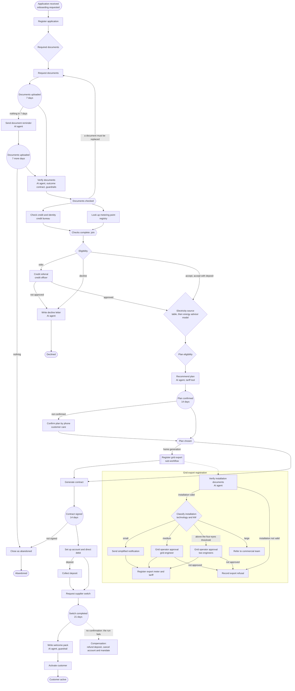

# Electricity customer onboarding

A reference example a utility can take off the shelf: the onboarding of a new household customer by an electricity supplier, from the web form to an active supply, written as two AWA 1.1 workflows and a journey that run end to end. Every system the process touches is a tool with a documented contract ([INTEGRATION.md](INTEGRATION.md)), every person acts under a name and a policy, and every step is in the journal.

Eight scenarios run it to their end with scripted agents and the reference adapters: no model, no API key and no external system is needed.

| File | What it is |
|---|---|
| `electricity-onboarding.awa.json` | The onboarding workflow |
| `grid-export-registration.awa.json` | The sub-workflow that registers home generation for export to the grid |
| `new-customer-onboarding.journey.json` | The journey "New customer onboarding": stages, touchpoints, goals, exits |
| `deployment.json` | Principals (the agents, the back-office applications, a credit officer, two grid engineers, a customer care agent), the authorization policy with a separation of duties and a four-eyes rule, two deployment guardrails, and the hosts the tools may reach |
| `INTEGRATION.md` | Every integration point: binding, request and response, what the reference adapter answers, the secret header |
| `adapters/mock-server.mjs` | The reference adapters: one Node HTTP server, no dependencies, that implements every integration point on port 4545 |
| `scenarios/*.json` | Eight scenarios: the application, what the outside world and the people do, what must be on record at the end |
| `scenarios/actors.json` | What each scripted actor does: the tools it calls, the time it takes, what it returns |
| `scenarios/play.mjs` | Plays a scenario on a host; used by `make-runs.mjs`, the demonstration and the TypeScript tests (the Python tests read the same files) |
| `make-runs.mjs` | Plays every scenario and writes `runs/`, `journeys.json`, `evidence/` and `bpmn/`, the same bytes every time |
| `runs/*.journal.jsonl` | The journal of each onboarding run, and of each grid export registration run |
| `journeys.json` | Every journey with its runs, in the form `awa journey export` writes |
| `evidence/evidence-report.{json,md,html}` | The evidence report of all of it (specification section 32) |
| `bpmn/electricity-onboarding.{bpmn,dmn}` | Both workflows in BPMN 2.0, and their decision tables in DMN (specification section 27) |
| `simulation.json`, `simulation-events.json` | What each activity returns, and the events that arrive, for a run in simulation |
| `demo/live.mjs` | A live demonstration, paced for a viewer |
| `demo/video.json` | The plan of the demonstration video for `tools/video/record.mjs`: its cards, chapters, captions and scenes, in English |
| `views/story-options.json` | The journey view's options for this example: how a customer is named, the hand layouts of both workflows, and the three bands of the onboarding workflow |
| `build-definitions.py` | Writes the three definitions, so that identifiers stay stable |

## The process



The journey that follows the household has seven stages: **Application**, **Verification**, **Energy choices**, **Grid export** (only for a home with generation), **Contract**, **Switch** and **Active**. Its goal is an active customer; it ends early when the application is abandoned or declined. Its touchpoints include the web form, the document upload, the e-signature and the welcome e-mail.

## What it shows

| Feature | Where |
|---|---|
| Business events, correlated waits with deadlines (18) | `documents.uploaded` (7 days, a reminder, 7 more days), `plan.confirmed`, `contract.signed`, `switch.completed`, all correlated on `application_id` |
| Published events that move the journey (18.2, 19.5) | `onboarding.verified`, `plan.chosen`, `grid_export.completed`, `customer.activated`, `onboarding.declined`, `onboarding.abandoned` |
| An AI agent under an outcome contract, with escalation to a person (11) | Verify documents and Verify installation documents: every required document checked, every one legible, confidence of at least 0.75, budgets; otherwise a person decides. An installation found not valid, by the agent or the person, goes to Record export refusal and is neither classified nor registered |
| Guardrails (31) | `prompt_injection` at stage `tool_result` on the documents the verifiers read; `personal_data` redaction of the verifiers' notes; no IBAN or phone number in the welcome message; and, in the deployment, `prompt_injection` on every agent's input and IBAN redaction on every agent's output |
| Parallel split and synchronising join (13.1, 13.2) | Credit and identity check beside the metering point lookup, joined at Checks complete |
| Decision tables (5.5) | Required documents and Plan eligibility (hit policy `collect`), Eligibility, Electricity source, Classify installation (`first`) |
| A model deciding within enumerated options (16) | Electricity source: when no rule offers the chosen source in the region, the energy advisor (`tier:fast`) proposes the closest available one and gives its reason |
| Sub-workflow (24) | Register grid export is a call activity (`is_expandable`, `expansion_workflow_id`) with `subworkflow` input and output mapping |
| Contexts (22) | `customer_profile`, written by Register application and read only by the agents that need it: the document verifier, the reminder writer, the plan advisor and the welcome writer; the credit results are not in it |
| Service levels (23) | The whole onboarding (target 21 days, at most 35) and Verify documents (target 15 minutes, at most 2 hours) |
| Compensation (13.6) | A switch the registry never confirms fails the run; the deposit is refunded and the account and mandate are cancelled, each through its own tool |
| Tools over HTTP and JSON-RPC, each call journalled with its link (17) | 15 integration points ([INTEGRATION.md](INTEGRATION.md)) |
| Identity and authorization (30) | `deployment.json`: who may decide what; a separation of duties (whoever resolved an installation file may not approve its export); a four-eyes rule on exports above the threshold; refusals on record |
| Model tiers (12.2) | Roles name `tier:reasoning` (the verifiers), `tier:balanced` (plans, letters) and `tier:fast` (reminders, the energy advisor) |
| Journey with touchpoints, artefacts, goals, exits and mood (19) | `new-customer-onboarding.journey.json` |
| Evidence report (32) and BPMN/DMN export (27) | `evidence/`, `bpmn/` |

## The scenarios

| Scenario | What happens | End |
|---|---|---|
| `a-standard-renewable` | A flat with a smart meter: 100% renewable electricity and a 12-month fixed plan. The welcome message names the customer's mobile number; a guardrail redacts it | Run completed, journey completed |
| `b-solar-prosumer` | 6.2 kW of solar, the prosumer plan, local community energy. The commissioning report carries an instruction to the reviewing system: the document's content is withheld, the verifier escalates, Hana (grid engineer) checks it by hand. Having resolved the file, Hana is refused the approval (separation of duties); Gabriel approves 6.0 kW | Run and child run completed (export registered), journey completed |
| `c-small-wind` | A 2.5 kW wind turbine: a simplified notification, no person. Local community energy is not offered in the region: the energy advisor proposes 100% renewable | Run and child run completed, journey completed |
| `d-chp-four-eyes` | A 7.5 kWe heat-and-power unit, above the four-eyes threshold. No plan confirmed in 14 days: Marco (customer care) calls. Gabriel approves, is refused a second approval, Hana approves | Run and child run completed, journey completed (stalled for a while in Energy choices) |
| `e-documents-late` | No documents in 7 days: a reminder; they arrive two days later. The proof of address is illegible twice: Marco checks it, three hours later, past the service level | Run completed, `sla.breached` on Verify documents, journey completed |
| `f-credit-referral` | Credit band D: referred. Marco may not decide; Olivia (credit officer) approves with a deposit of 200 EUR, which is collected | Run completed, journey completed |
| `g-declined` | An energy debt of 1,850 EUR: declined, with a letter by post | Run completed by the Declined end, journey abandoned ("Declined on eligibility") |
| `h-switch-not-confirmed` | Accepted with a deposit; the registry never confirms the switch | Run failed with `EVENT_TIMEOUT`, deposit refunded, account and mandate cancelled, journey stalled in Switch |

## Run it in simulation

Nothing is called in simulation: each activity returns what `simulation.json` says. A workflow that waits for business events needs them delivered, so the simplest way is through a runtime directory, one event at a time, with the journey commands:

```bash
cd examples/electricity-onboarding
awa journey add electricity-onboarding.awa.json grid-export-registration.awa.json new-customer-onboarding.journey.json
awa journey publish onboarding.requested --simulate --outputs simulation.json -d '{"application_id": "APP-24001"}'
awa journey publish documents.uploaded --simulate --outputs simulation.json -d '{"application_id": "APP-24001", "documents": [{"type": "proof_of_identity", "file_id": "F-1"}], "mandate_reference": "MND-24001"}'
awa journey publish plan.confirmed --simulate --outputs simulation.json -d '{"application_id": "APP-24001", "plan": "fixed_12"}'
awa journey publish contract.signed --simulate --outputs simulation.json -d '{"application_id": "APP-24001", "contract_signed": true}'
awa journey publish switch.completed --simulate --outputs simulation.json -d '{"application_id": "APP-24001", "switch_completed": true, "supply_start_date": "2026-12-01"}'
awa journey show APP-24001
```

`awa run electricity-onboarding.awa.json --simulate --outputs simulation.json --workflows grid-export-registration.awa.json` runs one onboarding until its first wait (`waiting_event`): a single command cannot deliver the events.

## Run it with the adapters

The scenarios, with the reference adapters called in this process and the scripted agents. No API key:

```bash
cd sdk/typescript && npm install && npm run build
```

```bash
node examples/electricity-onboarding/make-runs.mjs
```

It prints each scenario's outcome and writes `runs/`, `journeys.json`, `evidence/` and `bpmn/`. Open `tools/visualization/journey.html?data=<url of journeys.json>` or `tools/visualization/dashboard.html?data=<url of journeys.json>` to see the journeys and their measures (serve the repository over HTTP, for example with `npx http-server` at its root).

The adapters alone, for your own runs or tools:

```bash
node examples/electricity-onboarding/adapters/mock-server.mjs            # port 4545; --port <n> for another, 0 for any free one
```

The evidence report and the BPMN export again, from the files:

```bash
awa evidence examples/electricity-onboarding/journeys.json --as-of 2027-03-24T03:07:07.000Z --format md -o evidence-report.md
awa export bpmn examples/electricity-onboarding/electricity-onboarding.awa.json examples/electricity-onboarding/grid-export-registration.awa.json -o onboarding.bpmn
```

## Run it live

```bash
node examples/electricity-onboarding/demo/live.mjs                       # the prosumer onboarding, in about 70 seconds
node examples/electricity-onboarding/demo/live.mjs --scenario all --speed 2
```

| Option | Default | Meaning |
|---|---|---|
| `--port <n>` | 4600 | The port of the AWA server and its views |
| `--speed <x>` | 1 | How much faster than the default pace the timeline plays |
| `--scenario <name>` | `solar-prosumer` | One scenario by name, or `all`, one after the other |
| `--adapters-port <n>` | 4545 | The port of the reference adapters; the tools are pointed at it |
| `--then all` | none | After the chosen scenario, plays every other scenario, so that the journey view and the measures fill with customers |
| `--then-speed <x>` | the value of `--speed` | The speed of the scenarios that `--then` adds |
| `--then-pause <s>` | 0 | Seconds to wait, whatever the speed, between the chosen scenario and those `--then` adds |

The demonstration starts the reference adapters, an AWA host in the process (an `AwaRuntime` with both workflows and the journey), scripted AI agents whose work takes one to three seconds, tools that really call the adapters over HTTP, and the SDK's HTTP server (`createServer` with `set_journey_runtime`). Then it plays the timeline: the application, the documents, the people completing their tasks under their own names, the signed contract, the completed switch. The business clock jumps where the scenario says hours or days pass.

Each line of standard output is a JSON object: `{"t": <ms since start>, "kind": "action" | "event", "actor": ..., "text": ..., "run_id": ..., "instance_id": ...}`. An `action` is something done to the host (an event published, a task completed); an `event` is something the host recorded (an activity completed, a tool called, a decision, a guardrail, a refusal, a journey stage). `text` is a sentence a viewer reads, "Verify installation documents reads the commissioning report through the extraction service."; `actor` says who acted: `customer`, `system`, `agent` (an AI agent), `person`, `guardrail`, `refused` or `journey`. An `event` line also carries `event`, the type of the record it tells, and `workflow`; `subworkflow.started` and `subworkflow.completed` carry `child_run_id`, and `journey.stage_entered` carries `stage`. The first line, of kind `ready`, gives the views; the last, of kind `done`, gives the views of the main scenario's run:

- `http://localhost:4600/views/journey.html?live=http://localhost:4600`: the journeys as they move;
- `http://localhost:4600/views/dashboard.html?live=http://localhost:4600`: their measures;
- `http://localhost:4600/views/replay.html?run=http://localhost:4600/api/v1/workflows/runs/<run id>`: one run, step by step, live. The script serves `GET /api/v1/workflows/runs/<run id>/workflow`, `/events` and `/events/stream` (Server-Sent Events) for every run the host starts, child runs included.

It keeps serving after the timeline, and stops cleanly on Ctrl+C.

Each action is written before the host performs it, so that a reader meets the action before its effects. With `--then all`, a line of kind `phase` marks the start of the other scenarios, and their actions carry `"main": false`.

## Its dossier and its recommendations

[`dossier/`](dossier) holds the professional edition of this journey's dossier as [HTML](dossier/new-customer-onboarding.professional.html), [PDF](dossier/new-customer-onboarding.professional.pdf) and [DOCX](dossier/new-customer-onboarding.professional.docx): the eight households, Tomás Reyes and Sofia Lind telling their journey in their own words with the record beside them, the work behind it, the analysis, and the eight recommendations the rules find, each with its evidence and owner. `node tools/dossier/make-dossiers.mjs` writes it again ([tools/dossier](../../tools/dossier/README.md)).

The journey view's Recommendations tab shows the same eight recommendations; the options in `views/story-options.json` add one of the journey's own (a payment plan before declining) and its words for the others. [`recommendations/`](recommendations) holds the counterfactual replays that measure one of them: setting the attempt budget of the document checks to one gives 2 attempts instead of 4 and 7 minutes of agent time instead of 14, with the same path and no regression (`node tools/visualization/recommendation-replay.mjs`).

## Record a video of it

[`tools/video`](../../tools/video/README.md) records the live demonstration as a video of about two and a half minutes, in English. The frame shows the real journey view and measures page following the host, the record as it is written, four measures computed from it, and a caption for each step. Tomás Reyes, whose home has solar panels, applies; his journey is followed as a living blueprint; the run behind it is shown one band at a time; the child run that registers his export to the grid shows a guardrail withholding a report that carries hidden instructions, the agent handing the file to Hana, Hana refused the approval by the separation of duties and Gabriel approving; his journey reaches its goal. Then seven more customers, eight times faster, and the measures page, opened on the customer who is stuck, a journey opened into its stages and a number opened to the customers behind it.

```bash
cd sdk/typescript && npm install && npm run build && cd ../..
node tools/video/record.mjs \
  --demo "node examples/electricity-onboarding/demo/live.mjs --port 4610 --speed 1 --then all --then-speed 8 --then-pause 14" \
  --api http://localhost:4610 --script examples/electricity-onboarding/demo/video.json --out awa-electricity-onboarding.mp4
```

`demo/video.json` is the plan of the video: the cards, the chapters, the captions, and the scenes, each waiting for a line of the demonstration and moving the journey view through its own links. The views get `?options=views/story-options.json`, which names the customers from their application, lays out both workflows by hand, and wraps the 43 steps of the onboarding workflow into three bands, so that each band can be read at full size in the run view.

## Adapt it

- **Plans and sources.** Plan eligibility and Electricity source are decision tables in `electricity-onboarding.awa.json`. Add a plan as a rule of Plan eligibility (and to the enumerations of the contracts that name plans); add a source as a rule of Electricity source and, if the energy advisor may propose it, as an option of its `decision_model`. The regions a community scheme supplies are the second entry of the rule "Local community energy".
- **Thresholds.** The installation classes of Classify installation in `grid-export-registration.awa.json` are **examples**: 3.68 kW for a small inverter-connected installation, 2 kW for a small rotating machine, four eyes above 5 kW for a rotating machine and above 10 kW for an inverter, the commercial team above 50 kW. Thresholds differ by country and by grid operator; each operator edits this table to its own. The eligibility limits (an energy debt above 1,000 EUR, credit band E) are examples too.
- **Documents.** The rules of Required documents list what an application needs.
- **People and permissions.** `deployment.json` names who may decide what. Add your credit officers, grid engineers and customer care agents as principals with the roles the rules name, or plug in your own policy engine as a decider (specification 30.7).
- **Adapters.** Each tool's address is in the workflow; [INTEGRATION.md](INTEGRATION.md) gives the contract each system must meet. `build-definitions.py` writes the three definitions from one place: change `ADAPTERS` there, or a tool's path, and run it again.
- **Agents.** The roles name model tiers, never a model; the deployment maps each tier to a model (specification 12.2). The procedures and outcome contracts say what each agent must deliver, whatever model does it.

## Taking it into production

1. **Replace the adapters.** Point each tool at your system (or at a thin facade in front of it that speaks the contract of [INTEGRATION.md](INTEGRATION.md)), and list the hosts in `tools.allowed_hosts`: nothing else can be reached.
2. **Set the secrets.** Each HTTP tool's header names a secret (`{{secret:CRM_TOKEN}}` and the others). Give them to the host from your secret store; they are never journalled. Put the JSON-RPC endpoints behind mutual TLS or a gateway, since a JSON-RPC binding carries no header.
3. **Enable the policy.** Start the host with `deployment.json` (`awa serve --deployment deployment.json`, or the engine option `authorization`): people sign in, and each answer to a task is decided for who gives it. Map your identity provider's roles to `credit_officer`, `grid_engineer` and `customer_care`.
4. **Configure the models.** Map `tier:reasoning`, `tier:balanced` and `tier:fast` to the models your organisation approves, and keep the guardrails of the workflow and the deployment.
5. **Keep the journals.** Keep the runtime state and the journals durably (a runtime directory with `AWA_DATA_DIR`, or a PostgreSQL store shared by several hosts with `AWA_RUNTIME_STORE`, specification 19.10 and 29), for as long as your retention rules say. The application's personal data is in the run's input: journal payloads as `hash` where the law asks for it (specification 9.4). Produce evidence reports from them with `awa evidence`.
