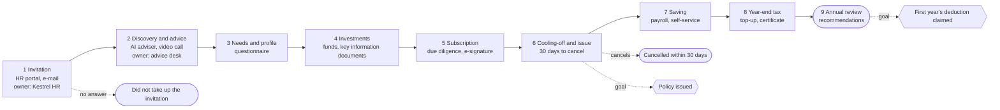
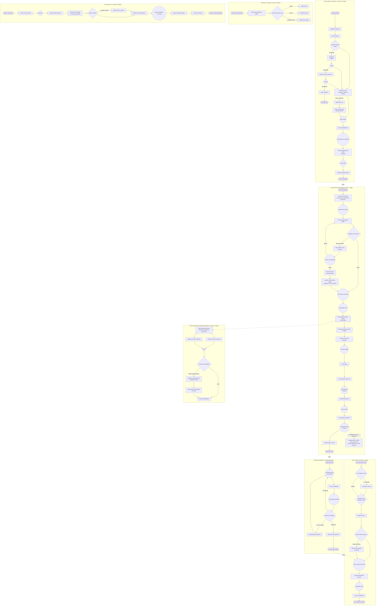

# Workplace pension savings with a Luxembourg life insurer

A reference example an insurer can take off the shelf: an employee's whole way through a pension savings plan that a Luxembourg life insurer runs for an employer, from the invitation in the HR portal to the tax return and the annual review, written as seven AWA 1.1 workflows and one journey that run end to end. Advice by an AI adviser and by licensed advisers, the questionnaire of the Insurance Distribution Directive, a choice of unit-linked funds with their key information documents, customer due diligence with four eyes for a politically exposed person, 30 days to cancel with a full refund, a year of payroll contributions and self-service, the deduction under Art. 111bis LIR, the tax certificate, and recommendations. Every system the process touches is a tool with a documented contract ([INTEGRATION.md](INTEGRATION.md)), every person acts under a name and a policy, and every step is in the journal.

Eight scenarios run it to their end with scripted agents and the reference adapters: no model, no API key and no external system is needed.

**Everything here is fictional**: the insurer Valoria Life S.A., the employer Kestrel Engineering S.à r.l., the custodian bank, the funds and the people. **This is not tax or legal advice.** The Luxembourg rules the workflows apply are listed in [FACTS.md](FACTS.md), each with its source and a mark where a tax adviser must confirm it.

| File | What it is |
|---|---|
| `plan-invitation-and-advice.awa.json` | Stages 1 to 3: the invitation and its reminders, the AI adviser's explanation, a video call with a licensed adviser, the questionnaire, the demands and needs, the risk profile |
| `savings-plan-subscription.awa.json` | Stages 4 to 6: the investment proposal, the check of the choice against the profile, the due diligence, the beneficiary clause, the e-signature, the policy, the payroll deduction, the first premium and the 30 days to cancel |
| `identity-aml-and-tax-residence.awa.json` | The sub-workflow of the subscription: identity documents, PEP and sanctions screening, the CRS and FATCA self-certification, compliance and four eyes |
| `payroll-contributions.awa.json` | Stage 7: a year of monthly contributions, a statement each quarter, the close of the savings year |
| `self-service-change.awa.json` | Stage 7: a fund switch or a top-up asked for in the HR portal, checked against the profile |
| `year-end-tax.awa.json` | Stage 8: the deductible amount per article, a top-up proposal in November, a tax adviser for a cross-border worker, the certificate in January |
| `annual-review.awa.json` | Stage 9: the employee's changes of situation, the AI adviser's recommendations, a licensed adviser where they change the plan |
| `workplace-pension-savings.journey.json` | The journey "Workplace Pension Savings": nine stages, triggers, goals, exits, touchpoints, artefacts, mood |
| `deployment.json` | Principals (four agents, seven systems, two licensed advisers, three compliance people, a tax adviser, a back-office administrator), the policy with two separations of duties and a four-eyes rule, three deployment guardrails, and the hosts the tools may reach |
| `FACTS.md` | Every legal and tax figure, with its source and how sure it is |
| `INTEGRATION.md` | Every integration point: binding, request and response, what the reference adapter answers, the secret header; and the business events |
| `adapters/mock-server.mjs` | The reference adapters: one Node HTTP server, no dependencies, no state, that implements every integration point on port 4560 |
| `scenarios/*.json` | Eight scenarios: the invitation, what the employee, the people and the outside world do and when, what must be on record at the end |
| `scenarios/actors.json` | What each scripted actor does: the tools it calls, the time it takes, what it returns |
| `scenarios/play.mjs` | Plays a scenario on a host, or every scenario on one calendar; used by `make-runs.mjs`, the demonstration and the TypeScript tests (the Python tests read the same files) |
| `make-runs.mjs` | Plays every scenario and writes `runs/`, `journeys.json`, `evidence/` and `bpmn/`, the same bytes every time |
| `simulation.json`, `simulation-events.json` | What each activity returns, and the events that arrive, for a run in simulation |
| `runs/*.journal.jsonl` | The journal of every run, child runs included: 43 runs |
| `journeys.json` | Every journey with its runs, in the form `awa journey export` writes |
| `evidence/evidence-report.{json,md,html}` | The evidence report of all of it (specification section 32) |
| `bpmn/life-insurance-savings.{bpmn,dmn}` | The seven workflows in BPMN 2.0, and their decision tables in DMN (specification section 27) |
| `demo/live.mjs` | A live demonstration, paced for a viewer |
| `views/story-options.json` | The journey view's options: how an employee is named, the bands and hand layouts of the seven workflows, a glossary of the domain's terms, and the Valoria Life brand |
| `build-definitions.py` | Writes the seven workflows and the journey, so that identifiers stay stable |

## The journey



| Stage | Owner | At most | Complete when | Workflows |
|---|---|---|---|---|
| Invitation | Kestrel HR | 30 days | the invitation is opened | Plan Invitation and Advice |
| Discovery and advice | Valoria advice desk | 14 days | the plan has been explained | Plan Invitation and Advice |
| Needs and profile | Valoria advice desk | 21 days | a risk profile exists | Plan Invitation and Advice |
| Investments | Valoria advice desk | 21 days | the allocation is confirmed | Savings Plan Subscription |
| Subscription | Valoria subscription desk | 30 days | the contract is signed | Identity, AML and Tax Residence Checks (child run) |
| Cooling-off and issue | Valoria back-office | 60 days | the policy is in force | Savings Plan Subscription |
| Saving | Kestrel payroll | 300 days | the year-end review opens | Payroll Contributions, Self-Service Change |
| Year-end tax | Valoria tax desk | 100 days | the certificate is issued | Year-End Tax |
| Annual review | Valoria advice desk | 45 days | the review is done: the journey is complete | Annual Review |

The journey ends early when the invitation lapses, the subscription is not completed or is refused, or the employee cancels within the 30 days. Its goals are **Policy issued** and **First year's deduction claimed**. Its 30 touchpoints run over the HR portal, e-mail, the AI adviser's chat, video calls, the questionnaire, the e-signature service, the payroll, the custodian bank, the screening provider, the tax desk's phone and the tax certificate; its mood moves by declared rules, and is measured from the satisfaction the employee gives in the annual review.

## The workflows



The workflows are joined by business events, never by calling one another, except the subscription's call of its due diligence: `profile.completed` starts the subscription, `policy.in_force` the year's payroll contributions, `self_service.requested` a self-service change, and the insurer's calendar starts the year-end tax in November and the annual review at the policy's anniversary. The year-end tax waits for `savings_year.closed`, which the payroll contributions publish after the December payroll.

**Refined from the design.** The design names five workflows. Two refinements follow from the domain: the due diligence is its own workflow, called by the subscription as a sub-workflow, so that compliance decisions are one record with their separations of duties; and stage 7 has two workflows, Payroll Contributions (one run a year, the monthly payroll in a loop) and Self-Service Change (one run per request), because a run waits for one kind of event at a time and an employee asks for a change at any moment. The payroll contributions start when the policy is in force, so that the January payroll pays the first premium in the subscription and the next ones are invested by the year's run.

## What it shows

| Feature | Where |
|---|---|
| A journey over seven workflows (19) | Nine stages with owners and maximum durations, triggers that start workflows on events, goals, four exits, 30 touchpoints, 21 artefacts, mood rules with a measured satisfaction |
| Business events, correlated waits with deadlines (18) | `invitation.opened` (7 days, a reminder, 7 more, a last reminder, 14 more), `questionnaire.submitted`, `investments.chosen`, `contract.signed`, the monthly `payroll.contribution_paid`, `cooling_off.ended` after the 30 days (35 at most), `savings_year.closed` from one workflow to another |
| AI agents under outcome contracts, with escalation to a person (11) | Explain the plan (every topic covered, the risk stated, confidence of at least 0.8, else a licensed adviser); Assess demands and needs; Verify identity documents (else a compliance officer); Review beneficiary clause (shares add up to 100%, else the back-office); Warn about the risk; Write top-up proposal (the ceiling, the deadline and the tax caveat stated) |
| Guardrails (31) | `prompt_injection` at stage `tool_result` on the identity documents the agent reads (Ana); `personal_data` redaction of what the agents write (Eva); in the deployment, `prompt_injection` on every agent's input, IBAN redaction on every agent's output, and a `deny_list` with `retry_with_feedback` that blocks any promise of a guaranteed return on unit-linked funds (Eva) |
| Sub-workflow (24) | Run identity and AML checks: a call activity with `subworkflow` input and output mapping; its compliance tasks are completed through the parent |
| Parallel split and synchronising join (13.1, 13.2) | The screening beside the self-certification check, joined at Checks back |
| Decision tables (5.5) | Risk profile, Suitability of the choice, Customer due diligence, After the contribution (`ends with`, `matches`), Change within the rules (a range), Tax residence route, **Deduction rules** (hit policy `collect`, the ceilings of Art. 111bis, 111 and 110 LIR as data), Top-up worth proposing, Adviser needed |
| Compensation (13.6) and cancellation (5.8) | Marc cancels within 30 days: the journey's exit withdraws the subscription run, and compensation sells the units and refunds the premium in full, stops the payroll deduction and cancels the policy, in reverse order |
| Identity and authorization (30) | `deployment.json`: who may decide what; whoever resolved a compliance alert may not approve the relationship (Sara: Inès refused); the adviser who discussed a choice above the profile may not approve it (Mireille, in the tests); four eyes for a politically exposed person (Jonas and Claire; Jonas's second approval refused) |
| Contexts (22) | `employee_profile`, written by Register enrolment and read by the agents that need it; no salary and no identity document in it |
| Service levels (23) | Advice within six weeks, the policy in force within two months, the certificate by February, compliance alerts within two days, cross-border tax files within ten days (Ana's breaches it) |
| Tools over HTTP and JSON-RPC, each call journalled with its link (17) | 27 integration points over nine systems ([INTEGRATION.md](INTEGRATION.md)) |
| Model tiers (12.2) | Roles name `tier:reasoning` (advice, documents, recommendations), `tier:balanced` (proposals, warnings, clauses) and `tier:fast` (reminders) |
| Measures, evidence and interchange (21, 32, 27) | `journeys.json` opens in the measures page; `evidence/`, `bpmn/` |

## The scenarios

| Scenario | What happens | End |
|---|---|---|
| `a-lea-full-year` | Léa Muller, 34, asks the AI adviser for a person: Hugo advises her by video call. Balanced profile, the balanced model portfolio, 375 EUR a month. Eleven more contributions after the first premium, a statement each quarter, a switch to the climate fund in May within her profile. No top-up needed in November; her certificate states 4,500 EUR deductible under Art. 111bis for 2026. She claimed it, and accepts a rebalancing | Journey completed, both goals |
| `b-tom-above-profile` | Tom puts everything in a technology fund of risk indicator 6, above the 4 his profile allows: warned, he adjusts to 3.6. A switch above his profile in September is declined. A top-up of 1,500 EUR is proposed in November, which he does not take: 3,000 EUR deductible | Journey completed, both goals |
| `c-ana-cross-border` | Ana lives in France: her policy is reportable under CRS. Her proof of address carries a hidden instruction: the guardrail withholds it, the agent escalates, Jonas checks it by hand. At year end her file goes to Yann, tax adviser, who answers in 14 days, past the service level: she can opt for assimilation and deduct 4,500 EUR | Journey completed, both goals; `sla.breached` |
| `d-marc-cancels` | Marc's first premium of 200 EUR is invested; eleven days after receiving his policy documents he cancels. The subscription run is withdrawn and compensated: units sold and 200 EUR refunded, deduction stopped, policy cancelled | Journey abandoned ("Cancelled within the 30-day period"), goal Policy issued |
| `e-sara-pep` | Sara is a politically exposed person: enhanced due diligence. Inès resolves the alert and is refused the approval (separation of duties); Jonas approves, is refused a second approval (four eyes), Claire gives it. Named beneficiaries, her two children | Journey completed, both goals |
| `f-nina-never-answers` | Nina never opens the invitation: a reminder by the AI agent after 7 days, Kestrel HR's last reminder after 14, the invitation lapses after 28 | Journey abandoned ("Did not take up the invitation") |
| `g-paul-top-up` | Paul saves 300 EUR a month: in November the projection is 3,600 EUR, 900 below the ceiling. He tops up 900 EUR in self-service, collected with his December salary: 4,500 EUR deductible | Journey completed, both goals |
| `h-eva-guarantee-blocked` | Eva, 56, retires at 63 and married this year. The AI adviser's first recommendation promises a guaranteed 3% return: blocked, and written again; the second quotes her husband's phone number: redacted. Hugo confirms; she moves to the moderate portfolio and names her husband | Journey completed, both goals |

In `make-runs.mjs` the eight employees live on one calendar, from Kestrel's opening of the plan on 12 January 2026 to the last annual review on 31 January 2027; 6 of the 8 journeys complete.

## The Luxembourg rules it applies

The year-end tax applies the decision table **Deduction rules**, whose ceilings are data an insurer updates without touching code:

| Article | What | Ceiling in the table | How sure |
|---|---|---|---|
| Art. 111bis LIR | Pension savings contract (prévoyance-vieillesse), the plan of this example | 4,500 EUR a year per taxpayer from tax year 2026, 3,200 EUR before, whatever the age | Confirmed by the tax administration; whether the ceiling is per taxpayer or per contract is to be confirmed |
| Art. 111 LIR | Life insurance and other premiums | 672 EUR a year per member of the household, shared with other premiums | Confirmed; a raise to 900 EUR from 2028 is not confirmed and is not in the table |
| Art. 110 LIR | Personal contributions to an employer's supplementary pension scheme (law of 8 June 1999) | 1,200 EUR a year | Confirmed by the tax administration's page |

The contract runs at least ten years and pays out from age 60 to 75. A cross-border worker deducts only after opting to be assimilated to a resident (Art. 157ter LIR), which depends on their situation: the workflow sends their file to a tax adviser. The 30 days to cancel are those of Art. 100 of the law of 27 July 1997 on the insurance contract; the full refund is a term of this fictional plan. The unit-linked investment rules are those of the Commissariat aux Assurances' circular letter 26/1, which replaced 15/3 in February 2026; the assets covering the policies sit with a custodian bank, apart from the insurer's own (the triangle of security). Every figure, with its source and its mark, is in [FACTS.md](FACTS.md).

**Not tax or legal advice.** The figures are examples of how an insurer encodes the rules. A tax adviser confirms them for the year concerned, and for the employee's own situation.

## AI and the EU AI Act

Under the EU AI Act, AI systems intended for the risk assessment and pricing of natural persons in life and health insurance are high-risk (Annex III, point 5(c)). This example uses no AI for pricing or underwriting: the plan is a pure savings product, with no death cover to underwrite, and its price is the plan's fixed fees. The agents explain, draft, read documents and recommend; the risk profile is a decision table, and every compliance decision (identity, screening alerts, a politically exposed person, a choice above the profile) is taken by a named person under the deployment's policy. See [docs/compliance/eu-ai-act.md](../../docs/compliance/eu-ai-act.md) for how AWA's records serve the Act's obligations.

## Run it in simulation

Nothing is called in simulation: each activity returns what `simulation.json` says, and the waits take the business events of `simulation-events.json`. Through a runtime directory, one event at a time, with the journey commands:

```bash
cd examples/life-insurance-savings
awa journey add *.awa.json workplace-pension-savings.journey.json
awa journey publish savings.invited --simulate --outputs simulation.json -d '{"enrolment_id": "ENR-26001", "plan_id": "KES-PENSION-111BIS", "tax_residence": "LU"}'
awa journey publish invitation.opened --simulate --outputs simulation.json -d '{"enrolment_id": "ENR-26001", "invitation_opened": true}'
awa journey show ENR-26001
```

`awa run savings-plan-subscription.awa.json --simulate --outputs simulation.json --workflows identity-aml-and-tax-residence.awa.json` runs one subscription until its first wait. The repository's tests run every workflow of the example in simulation to its end, delivering the events of `simulation-events.json`.

## Run it with the adapters

The scenarios, with the reference adapters called in this process and the scripted agents. No API key:

```bash
cd sdk/typescript && npm install && npm run build
```

```bash
node examples/life-insurance-savings/make-runs.mjs
```

It prints each scenario's outcome and writes `runs/`, `journeys.json`, `evidence/` and `bpmn/`. To see them, serve the repository over HTTP (for example `npx http-server` at its root) and open:

- `tools/visualization/journey.html?data=/examples/life-insurance-savings/journeys.json&options=/examples/life-insurance-savings/views/story-options.json`: the journeys, as an atlas, each employee's living blueprint, and each run in its bands, with the glossary and the Valoria Life brand;
- `tools/visualization/dashboard.html?data=/examples/life-insurance-savings/journeys.json&options=/examples/life-insurance-savings/views/story-options.json`: their measures.

The adapters alone, for your own runs or tools:

```bash
node examples/life-insurance-savings/adapters/mock-server.mjs            # port 4560; --port <n> for another, 0 for any free one
```

The evidence report and the BPMN export again, from the files:

```bash
awa evidence examples/life-insurance-savings/journeys.json --as-of 2027-01-31T10:00:40.000Z --format md -o evidence-report.md
awa export bpmn examples/life-insurance-savings/*.awa.json -o savings.bpmn
```

The documents again, after a change to `build-definitions.py`:

```bash
python3 examples/life-insurance-savings/build-definitions.py
awa validate examples/life-insurance-savings/*.awa.json examples/life-insurance-savings/workplace-pension-savings.journey.json
```

## Run it live

```bash
node examples/life-insurance-savings/demo/live.mjs                       # Léa's year, in about three minutes
node examples/life-insurance-savings/demo/live.mjs --scenario all --speed 4
```

| Option | Default | Meaning |
|---|---|---|
| `--port <n>` | 4620 | The port of the AWA server and its views |
| `--speed <x>` | 1 | How much faster than the default pace the timeline plays |
| `--scenario <name>` | `lea-full-year` | One scenario by name, or `all`, one after the other |
| `--adapters-port <n>` | 4560 | The port of the reference adapters; the tools are pointed at it |
| `--then all` | none | After the chosen scenario, plays every other one, so that the journey view and the measures fill with employees |
| `--then-speed <x>` | the value of `--speed` | The speed of the scenarios that `--then` adds |
| `--then-pause <s>` | 0 | Seconds to wait between the chosen scenario and those `--then` adds |
| `--then-calendar one` | `after` | Plays the scenarios that `--then` adds on one calendar from their own first days, as `make-runs.mjs` does, instead of one after the other: once the chosen scenario has ended, the business clock goes back to the plan's opening, so that every employee joins the same year and the record ends on 31 January 2027 |

The demonstration starts the reference adapters, an AWA host in the process with the seven workflows and the journey, scripted agents whose work takes one to three seconds, tools that really call the adapters over HTTP, and the SDK's HTTP server. The business clock starts on the scenario's first day and jumps where the timeline says days or months pass; a month's payroll goes by faster than the other steps. An agent's work also moves the business clock by the time its script says it takes, as in `make-runs.mjs`, so that the live record's durations are those of the committed one.

Each line of standard output is a JSON object: `{"t", "kind": "action" | "event", "actor", "text", "run_id", "instance_id"}`, with `actor` one of `customer` (the employee), `system`, `agent`, `person`, `guardrail`, `refused` and `journey`, and `text` a sentence a viewer reads: "Hugo, licensed adviser, advises Léa by video call.", "Issue tax certificate issues the 2026 tax certificate." The first line, of kind `ready`, gives the views; the last, of kind `done`, gives the views of the main scenario's first run. The script also serves every run's workflow and journal, as JSON and as Server-Sent Events, for `tools/visualization/replay.html`, like the electricity onboarding's demonstration.

## The demonstration video

`demo/video.json` is the plan of a video of this example in AWA's studio frame ([tools/video](../../tools/video/README.md)): Léa's year live under the Valoria Life brand, seven colleagues on the same calendar, the glossary, the Recommendations tab and the dossier.

```bash
node tools/video/record.mjs \
  --demo "node examples/life-insurance-savings/demo/live.mjs --port 4640 --adapters-port 4580 --speed 1.6 --then all --then-speed 16 --then-pause 3 --then-calendar one" \
  --api http://localhost:4640 --script examples/life-insurance-savings/demo/video.json --out awa-life-insurance-savings.mp4
```

The recording takes about four minutes (3 min 54 s):

| At | Chapter | The stage shows |
|---|---|---|
| 0:00 | Title card | What the viewer is about to see |
| 0:06 | Invitation | The journey view under the Valoria Life brand: the atlas, then Léa's blueprint as she opens the invitation in the HR portal |
| 0:15 | Advice, Profile | The run Plan Invitation and Advice, band by band, every name inside its box: the AI adviser hands her to Hugo by video call; the Risk profile table |
| 0:22 | Investments, Subscription | The subscription run (funds with their key information documents, the suitability check), then the due diligence child run |
| 0:38 | Cooling-off, Saving | Léa's blueprint: the e-signature, the policy issued, the payroll month by month, a switch to the climate fund |
| 0:54 | Glossary | A dotted word of the legend opens the glossary; a search for "111bis" finds the journey's term Art. 111bis LIR |
| 1:06 | Year-end tax, Annual review | The Year-End Tax run: the Deduction rules table (Art. 111bis, 4,500 EUR) and the certificate; then the annual review and both goals |
| 1:32 | Seven colleagues | Sixteen times faster on the same calendar; Tom's fund above his profile, Sara's separation of duties then four eyes, Eva's guaranteed return blocked, each at its step |
| 2:24 | Atlas | Every ending: six completed, Marc cancelled, Nina never answered |
| 2:31 | Recommendations | The impact and effort map settling; "Propose a top-up before 31 December" opened; the replay-measured hand-over, before and after (T) |
| 2:53 | Export dossier | The export dialog, then Export: the HTML edition made in the browser |
| 3:03 | Dossier, HTML | That edition: the cover's lines drawing, the counts, the summary |
| 3:11 | Dossier, PDF | The committed professional edition, pages turning: cover, summary, the journey at a glance and Tom's own words (moving in to read), analysis, recommendations |
| 3:34 | Léa's client edition | Her client edition under the Valoria brand, her own words |
| 3:45 | Closing card | What to replace to take the example into production |

The journey view, the recommendations and the HTML edition follow the live host; the pages that turn are those of the PDFs in [`dossier/`](dossier), made from the example's own record of the same eight members.

## Its dossier and its recommendations

[`dossier/`](dossier) holds two editions of this journey's dossier, as HTML, PDF and DOCX: Léa Muller's client edition under the Valoria Life brand ([HTML](dossier/lea-muller.client.html), [PDF](dossier/lea-muller.client.pdf), [DOCX](dossier/lea-muller.client.docx)), her own year in her own words with no other member named and no internal cost, and the professional edition of the whole journey ([HTML](dossier/workplace-pension-savings.professional.html), [PDF](dossier/workplace-pension-savings.professional.pdf), [DOCX](dossier/workplace-pension-savings.professional.docx)). `node tools/dossier/make-dossiers.mjs` writes them again ([tools/dossier](../../tools/dossier/README.md)).

The journey view's Recommendations tab ranks what to change; `views/story-options.json` adds the journey's own recommendations: propose a top-up before 31 December to a member below the 4,500 EUR Art. 111bis ceiling, and ask HR to talk to a member who lets the invitation lapse. [`recommendations/`](recommendations) holds the replay of the one a replay can measure.

## Adapt it

- **Tax rules.** Edit the decision table Deduction rules in `build-definitions.py` (a new rule per year or per contract type) and run it again. The tax computation service multiplies a ceiling "per household member" by `household_members`.
- **Advice policy.** The bands of Risk profile and the plan's model portfolios are examples each insurer replaces with its own advice policy; the suitability check compares the weighted summary risk indicator of a choice with the profile's maximum.
- **Due diligence.** Customer due diligence is a decision table: add a rule for a high-risk country, an adverse media hit or a US person's documents.
- **People and permissions.** `deployment.json` names who may decide what. Map your identity provider's roles to `licensed_adviser`, `compliance_officer`, `senior_management`, `tax_adviser` and `back_office`, or plug in your own policy engine as a decider (specification 30.7).
- **Adapters.** Each tool's address is in `build-definitions.py` (`ADAPTERS`); [INTEGRATION.md](INTEGRATION.md) gives the contract each system must meet.
- **Agents.** The roles name model tiers, never a model; the deployment maps each tier to a model (specification 12.2). The procedures and outcome contracts say what each agent must deliver, whatever model does it.

## Taking it into production

1. **Replace the adapters.** Point each tool at your system, or at a thin facade that speaks the contract of [INTEGRATION.md](INTEGRATION.md), and list the hosts in `tools.allowed_hosts`.
2. **Set the secrets.** Each HTTP tool's header names a secret (`{{secret:POLICY_ADMIN_TOKEN}}` and nine others); give them to the host from your secret store. Put the payroll and custodian JSON-RPC endpoints behind mutual TLS or a gateway.
3. **Enable the policy.** Start the host with `deployment.json` (`awa serve --deployment deployment.json`): people sign in, and each answer to a task is decided for who gives it.
4. **Configure the models.** Map `tier:reasoning`, `tier:balanced` and `tier:fast` to the models your organisation approves, and keep the guardrails of the workflows and the deployment.
5. **Keep the journals.** Keep the runtime state and the journals durably (`AWA_DATA_DIR`, or a PostgreSQL store with `AWA_RUNTIME_STORE`), for as long as insurance and anti-money-laundering rules require. The employee's personal data is in the runs' input: journal payloads as `hash` where the law asks for it (specification 9.4). Produce evidence reports from them with `awa evidence`.
6. **Have the rules confirmed.** Have a tax adviser confirm the figures of [FACTS.md](FACTS.md) for the tax year, and a lawyer the right to cancel and the due diligence steps.
