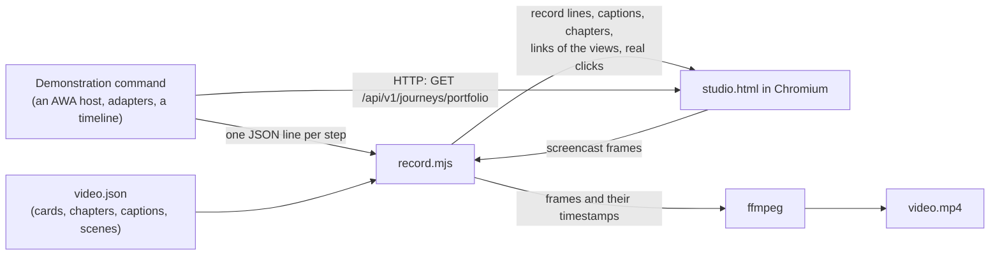

# Recording a demonstration video

These two files record a live AWA execution as a video: the real journey view and measures page, the record as the host writes it, the measures computed from it, and a caption, in one 1920 × 1080 frame.

| File | What it does |
|---|---|
| `studio.html` | The frame. A header with the example's name, its chapters (the current one highlighted), "live" and the elapsed time; the **stage**, where the journey view (`tools/visualization/journey.html`, 1440 × 900) runs at its own size, and for the measures the measures page (`dashboard.html`) in the same place; a **rail** with who the video follows (the customer, what they have, the stage, where the run stands, the mood), the record as it is written (each line with its time and who acted: customer, system, AI agent, person, guardrail, refused, journey) and four measures (journeys started, reached the goal, done without a person, cost per journey), computed from the live record by `awa-kpis.js`, the code the measures page uses; and a **caption** under the stage, with the step number. |
| `record.mjs` | Starts a demonstration command, reads its lines, plays the scenes of a script, captures every frame the page paints through the Chrome DevTools screencast, and encodes the frames as an H.264 video with ffmpeg. |



The views on the stage are the real pages, following the host live. The camera only chooses which page and which place, through the views' own links (the journey view's address, `#level/journey/customer/run/position`) and real clicks inside the page. `record.mjs` serves the repository over HTTP, so the studio and the views come from one origin and the recorder can click inside them.

## Record the electricity onboarding example

The SDK must be built, because the demonstration loads it from `sdk/typescript/dist`.

```bash
cd sdk/typescript && npm install && npm run build
```

```bash
node tools/video/record.mjs \
  --demo "node examples/electricity-onboarding/demo/live.mjs --port 4610 --speed 1 --then all --then-speed 8 --then-pause 14" \
  --api http://localhost:4610 --script examples/electricity-onboarding/demo/video.json --out awa-electricity-onboarding.mp4
```

The recording takes about two and a half minutes:

| Chapter | The stage shows |
|---|---|
| Title card | What the viewer is about to see |
| Application, Verification | The journey atlas, then Tomás Reyes's journey as a living blueprint (his mood, the touchpoints, the systems called, the documents exchanged), at its latest moment |
| Energy choices | The run behind the moment, with the band "Energy choices and grid export" in focus |
| Grid export | The child run Grid Export Registration: a guardrail withholds a report carrying hidden instructions, the agent hands the file to Hana, Hana is refused the approval, Gabriel approves |
| Contract, Switch, Active | Tomás's journey again, to its goal; then the main run whole, band by band |
| Seven more customers | Eight times faster: the journey on calendar time fills, then the atlas with every ending |
| Measures | The measures page: who needs someone now, the journey opened into its stages, a number opened to the customers behind it |
| Closing card | What to replace to take the example into production |

## Options

| Option | Meaning |
|---|---|
| `--demo "<command>"` | The command that starts the demonstration. It runs from the repository's root. |
| `--api <url>` | Where the demonstration's HTTP interface answers. The views and the studio follow `<url>/api/v1/journeys/portfolio`. |
| `--script <file.json>` | The plan of the video (below). |
| `--out <file.mp4>` | The video to write. |
| `--intro <seconds>` | How long the title card stays while the demonstration starts. Default: the script's `intro.seconds`, else 5. |
| `--tail <seconds>` | How long the recording continues after the last scene. Default 2. |
| `--keep-frames` | Keeps the captured frames beside the video. |

## The script

Another example brings its own script; `examples/electricity-onboarding/demo/video.json` is a complete one.

| Key | Meaning |
|---|---|
| `title`, `chapters` | The example's name and its chapters, in order. A chapter is highlighted when a scene or a moment names it, or when the main customer's journey enters a stage of the same name; chapters only move forward. |
| `options` | The journey view's options (`tools/visualization/journey-story-builder.js`), relative to the repository: the views get `?options=` pointing at it, and the studio names customers by its `subject_name`. |
| `subjects` | By journey key, what the Now card says the customer has: `"APP-24002": "Solar home, 6.2 kW, EV charger · prosumer plan"`. |
| `intro`, `outro` | The cards: `tag`, `title`, `text`, `points` (short phrases), and for the intro `seconds`. |
| `caption_actions` | Whether each action of the main customer is a caption (default `true`). |
| `phase_record` | After the line of kind `phase`, the actors whose lines the record still shows; the others go too fast to read. |
| `moments` | Lines worth a caption or a chapter, each once: `{ "on": <match>, "caption"?, "chapter"? }`. |
| `scenes` | What the stage shows, in order (below). |

A **match** is an object whose keys are fields of a demonstration line, each a regular expression the field must match: `{ "event": "subworkflow.started", "customer": "main" }`. `"customer": "main"` asks for a line of the first customer, before the `phase` line. A match may also be the string `"phase"` or `"done"`, for the line of that kind.

A **scene** starts when its line comes (`"on"`; `"start"` for the first scene, after the title card), or some seconds after the scene before it ends (`"after"`). Then, in order:

| Key | Does |
|---|---|
| `wait` | Waits that many seconds |
| `card` | Shows the card `"intro"` or `"outro"` |
| `chapter` | Highlights a chapter |
| `focus` | Whom the Now card follows: `"main"`, `"lines"` (the customer of each new line) or `"everyone"` (how all journeys stand) |
| `show` | Puts `"journey"` or `"measures"` on the stage |
| `place` | Moves the journey view to a place: `atlas/0/0/0/0`, `story/{j}/{i}/0/999` (the scene's customer at the latest moment), `run/{j}/{i}/{run}/999` (their main run), `run/{j}/{i}/{child}/999` (the child run the line names), `journey/0/0/0/999` (the journey on calendar time). The recorder waits until the record holds the run, and checks the view went there. |
| `caption` | A caption, with the next step number |
| `steps` | A list of `{ wait?, click?, scroll?, place?, caption? }`: a real click on, or a smooth scroll to, the first element matching a CSS selector in the page on the stage |
| `hold` | Waits that many seconds before the next scene |

The recording ends when the last scene ends, after `--tail` seconds.

## What a demonstration writes

The demonstration writes one JSON object per line on its standard output:

| `kind` | Meaning | The studio |
|---|---|---|
| `ready` | The servers listen | Ignores it |
| `action` | Something done to the host: an application, an upload, a person's decision | A line of the record; a caption for the main customer |
| `event` | Something the host recorded | A line of the record |
| `phase` | A new part of the demonstration begins | Scenes may wait for it |
| `done` | The last step | Scenes may wait for it |

A line of kind `action` or `event` carries `text`, a sentence a viewer reads, and `actor`: `customer`, `system`, `agent`, `person`, `guardrail`, `refused` or `journey`. An `event` line also carries `event`, the type of the record it tells, and where it applies `run_id`, `instance_id`, `workflow`, `child_run_id` (`subworkflow.started`, `subworkflow.completed`) and `stage` (`journey.stage_entered`). An action of a customer after the first carries `"main": false`.

## Requirements

Playwright with Chromium, and ffmpeg. Both are installed in the repository's development containers. The studio loads the Inter and Space Grotesk fonts from Google Fonts, and falls back to the fonts installed when it cannot.
