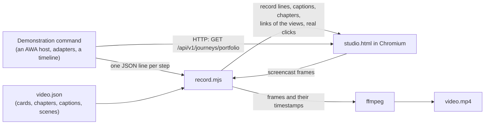

# Recording a demonstration video

These two files record a live AWA execution as a video: the real journey view and measures page, the record as the host writes it, the measures computed from it, and a caption, in one 1920 × 1080 frame. The stage can also hold a document: the pages of a PDF turning, or an HTML page such as the dossier the journey view has just made.

| File | What it does |
|---|---|
| `studio.html` | The frame. A header with the example's name, its chapters (the current one highlighted), "live" and the elapsed time; the **stage**, where the journey view (`tools/visualization/journey.html`, 1440 × 900) runs at its own size, and for the measures the measures page (`dashboard.html`) in the same place, or a **document**: two pages of a PDF side by side whose right page turns over to the next spread, with a move in to read a page, or an HTML page at its own size; a **rail** with who the video follows (the customer, what they have, the stage, where the run stands, the mood), the record as it is written (each line with its time and who acted: customer, system, AI agent, person, guardrail, refused, journey) and four measures (journeys started, reached the goal, done without a person, cost per journey), computed from the live record by `awa-kpis.js`, the code the measures page uses; and a **caption** under the stage, with the step number. |
| `record.mjs` | Starts a demonstration command, reads its lines, plays the scenes of a script, captures every frame the page paints through the Chrome DevTools screencast, and encodes the frames as an H.264 video with ffmpeg. The pages of a PDF the script names are drawn as images with `pdftoppm` before the recording starts. |



The views on the stage are the real pages, following the host live. The camera only chooses which page and which place, through the views' own links (the journey view's address, `#level/journey/customer/run/position`) and real clicks inside the page. `record.mjs` serves the repository over HTTP, so the studio and the views come from one origin and the recorder can click inside them.

## Record the electricity onboarding example

The SDK must be built, because the demonstration loads it from `sdk/typescript/dist`.

```bash
cd sdk/typescript && npm install && npm run build
```

```bash
node tools/video/record.mjs \
  --demo "node examples/electricity-onboarding/demo/live.mjs --port 4610 --speed 1 --then all --then-speed 8 --then-pause 14" \
  --api http://localhost:4610 --script examples/electricity-onboarding/demo/video.json --out awa-electricity-onboarding.mp4
```

The recording takes about two and a half minutes:

| Chapter | The stage shows |
|---|---|
| Title card | What the viewer is about to see |
| Application, Verification | The journey atlas, then Tomás Reyes's journey as a living blueprint (his mood, the touchpoints, the systems called, the documents exchanged), at its latest moment |
| Energy choices | The run behind the moment, with the band "Energy choices and grid export" in focus |
| Grid export | The child run Grid Export Registration: a guardrail withholds a report carrying hidden instructions, the agent hands the file to Hana, Hana is refused the approval, Gabriel approves |
| Contract, Switch, Active | Tomás's journey again, to its goal; then the main run whole, band by band |
| Seven more customers | Eight times faster: the journey on calendar time fills, then the atlas with every ending |
| Measures | The measures page: who needs someone now, the journey opened into its stages, a number opened to the customers behind it |
| Closing card | What to replace to take the example into production |

## Record the workplace pension savings example (video v3)

The second reference example, under its own brand: Léa Muller's year with Valoria Life, seven colleagues on the same calendar, the glossary, the Recommendations tab and the dossier. It needs `pdftoppm` (poppler) besides Playwright and ffmpeg.

```bash
node tools/video/record.mjs \
  --demo "node examples/life-insurance-savings/demo/live.mjs --port 4640 --adapters-port 4580 --speed 1.6 --then all --then-speed 16 --then-pause 3 --then-calendar one" \
  --api http://localhost:4640 --script examples/life-insurance-savings/demo/video.json --out awa-life-insurance-savings.mp4
```

The recording takes about four minutes (3 min 54 s):

| At | Chapter | The stage shows |
|---|---|---|
| 0:00 | Title card | What the viewer is about to see |
| 0:06 | Invitation | The journey view under the Valoria Life brand: the atlas, then Léa's blueprint as she opens the invitation in the HR portal |
| 0:15 | Advice, Profile | The run Plan Invitation and Advice, band by band, every name inside its box: the AI adviser hands her to Hugo by video call; the Risk profile table |
| 0:22 | Investments, Subscription | The subscription run (funds with their key information documents, the suitability check), then the due diligence child run |
| 0:38 | Cooling-off, Saving | Léa's blueprint: the e-signature, the policy issued, the payroll month by month, a switch to the climate fund |
| 0:54 | Glossary | A dotted word of the legend opens the glossary; a search for "111bis" finds the journey's term Art. 111bis LIR |
| 1:06 | Year-end tax, Annual review | The Year-End Tax run: the Deduction rules table (Art. 111bis, 4,500 EUR) and the certificate; then the annual review and both goals |
| 1:32 | Seven colleagues | Sixteen times faster on the same calendar; Tom's fund above his profile, Sara's separation of duties then four eyes, Eva's guaranteed return blocked, each at its step |
| 2:24 | Atlas | Every ending: six completed, Marc cancelled, Nina never answered |
| 2:31 | Recommendations | The impact and effort map settling; "Propose a top-up before 31 December" opened; the replay-measured hand-over, before and after (T) |
| 2:53 | Export dossier | The export dialog, then Export: the HTML edition made in the browser |
| 3:03 | Dossier, HTML | That edition: the cover's lines drawing, the counts, the summary |
| 3:11 | Dossier, PDF | The committed professional edition, pages turning: cover, summary, the journey at a glance and Tom's own words (moving in to read), analysis, recommendations |
| 3:34 | Léa's client edition | Her client edition under the Valoria brand, her own words |
| 3:45 | Closing card | What to replace to take the example into production |

The recommendations and the HTML edition come from the live record; the pages that turn are those of the PDFs committed in `examples/life-insurance-savings/dossier/`, made from the example's own record of the same eight members (`journeys.json`), and the caption says so.

## Options

| Option | Meaning |
|---|---|
| `--demo "<command>"` | The command that starts the demonstration. It runs from the repository's root. |
| `--api <url>` | Where the demonstration's HTTP interface answers. The views and the studio follow `<url>/api/v1/journeys/portfolio`. |
| `--script <file.json>` | The plan of the video (below). |
| `--out <file.mp4>` | The video to write. |
| `--intro <seconds>` | How long the title card stays while the demonstration starts. Default: the script's `intro.seconds`, else 5. |
| `--tail <seconds>` | How long the recording continues after the last scene. Default 2. |
| `--dpi <n>` | The resolution at which the pages of a PDF are drawn. Default 150, sharp enough to move in to read a page. |
| `--keep-frames` | Keeps the captured frames beside the video. |

## The script

Another example brings its own script; `examples/electricity-onboarding/demo/video.json` and `examples/life-insurance-savings/demo/video.json` are complete ones.

| Key | Meaning |
|---|---|
| `title`, `chapters` | The example's name and its chapters, in order. A chapter is highlighted when a scene or a moment names it, or when the main customer's journey enters a stage of the same name; chapters only move forward. |
| `options` | The journey view's options (`tools/visualization/journey-story-builder.js`), relative to the repository: the views get `?options=` pointing at it, and the studio names customers by its `subject_name`. |
| `subjects` | By journey key, what the Now card says the customer has: `"APP-24002": "Solar home, 6.2 kW, EV charger · prosumer plan"`. |
| `intro`, `outro` | The cards: `tag`, `title`, `text`, `points` (short phrases), and for the intro `seconds`. |
| `stage_chapters` | By stage name, the chapter it highlights when the chapter has a shorter name: `"Discovery and advice": "Advice"`. |
| `caption_actions` | Whether each action of the main customer is a caption (default `true`). |
| `caption_skip` | Matches of actions that are not captions, such as a monthly payroll: `[{ "kind": "action", "text": "payroll pays" }]`. |
| `phase_record` | After the line of kind `phase`, the actors whose lines the record still shows; the others go too fast to read. |
| `moments` | Lines worth a caption or a chapter, each once: `{ "on": <match>, "caption"?, "chapter"? }`. |
| `scenes` | What the stage shows, in order (below). |

A **match** is an object whose keys are fields of a demonstration line, each a regular expression the field must match: `{ "event": "subworkflow.started", "customer": "main" }`. `"customer": "main"` asks for a line of the first customer, before the `phase` line. A match may also be the string `"phase"` or `"done"`, for the line of that kind.

A **scene** starts when its line comes (`"on"`; `"start"` for the first scene, after the title card), or some seconds after the scene before it ends (`"after"`). Then, in order:

| Key | Does |
|---|---|
| `wait` | Waits that many seconds |
| `card` | Shows the card `"intro"` or `"outro"` |
| `chapter` | Highlights a chapter |
| `focus` | Whom the Now card follows: `"main"`, `"lines"` (the customer of each new line) or `"everyone"` (how all journeys stand) |
| `show` | Puts `"journey"` or `"measures"` on the stage |
| `document` | Puts the pages of a PDF on the stage: `{ "pdf": "<file in the repository>", "title": "<the line above the pages>" }` |
| `spread` | Opens the document at two pages, `[left, right]`, counted from 1; `0` is no page (`[0, 1]`: the cover alone, on the right). Moving forward, the right page turns over. |
| `zoom` | Moves in to read a page: `{ "side": "left" \| "right", "x": 0.7, "y": 0.35, "scale": 1.9 }`, the point of the page (0 to 1) brought to the centre; `null` shows the whole spread again |
| `html` | Puts an HTML page on the stage at its own size: a file of the repository, or `"made"`, the dossier the journey view made last with its export dialog; `{ "page": "made", "offset": 330 }` shows it from 330 pixels down from its first frame |
| `place` | Moves the journey view to a place: `atlas/0/0/0/0`, `story/{j}/{i}/0/999` (the scene's customer at the latest moment), `run/{j}/{i}/{run}/999` (their main run), `run/{j}/{i}/{lrun}/999` (the run of the line), `run/{j}/{i}/{child}/999` (the child run the line names), `journey/0/0/0/999` (the journey on calendar time). The last part may name a step of the run: `{step:guardrail}` the first of a kind (`guardrail`, `refused`, `human_wait`, `decision`), `{step:refused:2}` the second, `{step~Above the profile}` the first whose caption has the text. The recorder waits until the record holds the run, and checks the view went there. |
| `caption` | A caption, with the next step number |
| `steps` | A list of steps, each with any of the keys above and `wait`, `click`, `scroll`, `scroll_by`, `select` with `option`, `type` with `into`, `key`: a real click on, a smooth scroll to, an option chosen in, or text typed into the first element matching a CSS selector in the page on the stage; `scroll_by` scrolls that many pixels; `key` presses a key (`"t"`, `"Escape"`) |
| `hold` | Waits that many seconds before the next scene |

The recording ends when the last scene ends, after `--tail` seconds.

## What a demonstration writes

The demonstration writes one JSON object per line on its standard output:

| `kind` | Meaning | The studio |
|---|---|---|
| `ready` | The servers listen | Ignores it |
| `action` | Something done to the host: an application, an upload, a person's decision | A line of the record; a caption for the main customer |
| `event` | Something the host recorded | A line of the record |
| `phase` | A new part of the demonstration begins | Scenes may wait for it |
| `done` | The last step | Scenes may wait for it |

A line of kind `action` or `event` carries `text`, a sentence a viewer reads, and `actor`: `customer`, `system`, `agent`, `person`, `guardrail`, `refused` or `journey`. An `event` line also carries `event`, the type of the record it tells, and where it applies `run_id`, `instance_id`, `workflow`, `child_run_id` (`subworkflow.started`, `subworkflow.completed`) and `stage` (`journey.stage_entered`). An action of a customer after the first carries `"main": false`.

## Requirements

Playwright with Chromium, and ffmpeg. Both are installed in the repository's development containers. A script that shows a PDF needs `pdftoppm`, from poppler (`apt-get install poppler-utils`). The studio loads the Inter and Space Grotesk fonts from Google Fonts, and falls back to the fonts installed when it cannot.
