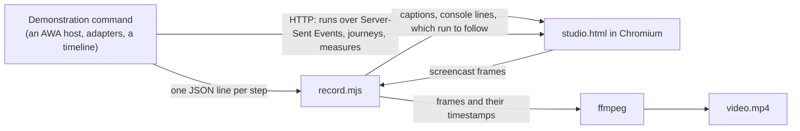

# Recording a demonstration video

These two files record a live AWA execution as a video, seen from four sides at once on one 1920 × 1080 screen.

| File | What it does |
|---|---|
| `studio.html` | Lays out four panes: the console of what happens, the run followed live in `replay.html`, the journeys in `journey.html`, and the measures in `dashboard.html`. The header shows a caption for each step. |
| `record.mjs` | Starts a demonstration command, drives the studio from the demonstration's output, captures every frame the page paints through the Chrome DevTools screencast, and encodes the frames as an H.264 video with ffmpeg. |



## Record the electricity onboarding example

The SDK must be built, because the demonstration loads it from `sdk/typescript/dist`.

```bash
cd sdk/typescript && npm install && npm run build
```

```bash
node tools/video/record.mjs --demo "node examples/electricity-onboarding/demo/live.mjs --port 4610 --speed 1 --then all --then-speed 8" --api http://localhost:4610 --script examples/electricity-onboarding/demo/video.json --lang en --out awa-electricity-onboarding-en.mp4
```

Use `--lang fr` for the French captions. The recording takes about two and a half minutes: a title card, the onboarding of a household with solar panels at real pace, seven more customers eight times faster, and a closing card.

## Options

| Option | Meaning |
|---|---|
| `--demo "<command>"` | The command that starts the demonstration. It runs from the repository's root. |
| `--api <url>` | Where the demonstration's HTTP interface answers. The journey view and the measures page follow it, and the run pane follows `<url>/api/v1/workflows/runs/<run id>`. |
| `--script <file.json>` | The texts of the video, by language: title and closing cards, pane labels, captions for chosen events, and translations of the console lines. `examples/electricity-onboarding/demo/video.json` is a complete example. |
| `--lang <code>` | The language taken from the script. Default `en`. |
| `--out <file.mp4>` | The video to write. |
| `--intro <seconds>` | How long the title card stays while the demonstration starts. Default 5. |
| `--tail <seconds>` | How long the recording continues after the demonstration's last step. Default 8. |

## What a demonstration writes

The demonstration writes one JSON object per line on its standard output:

| `kind` | Meaning | The studio |
|---|---|---|
| `ready` | The servers listen | Ignores it |
| `action` | Something done to the host: an application, an upload, a person's decision | Adds a console line in yellow and shows it as the caption |
| `event` | Something the host recorded | Adds a console line, coloured by who acted (agent, person) or by a refusal or failure |
| `phase` | A new part of the demonstration begins | Shows it as the caption; afterwards, the run pane follows each new run |
| `done` | The last step | Ends the recording after `--tail` seconds |

A line may carry `run_id`. The run pane follows the first run of the main scenario, follows its child run while the main run waits on it (specification section 24), and comes back to the main run when the child run completes.

## Requirements

Playwright with Chromium, and ffmpeg. Both are installed in the repository's development containers.
